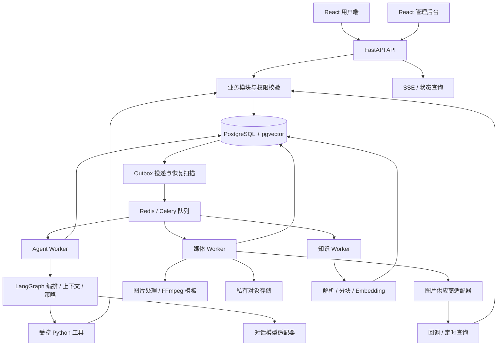

<!-- 文档职责：定义产品范围、架构行为与阶段验收；目录归属见项目结构，持久化约束见数据库设计，操作步骤见 runbooks。 -->
# 映序 · 项目开发文档

> 实施备注（2026-10-21）：用户已授权开始开发。本文保留设计目标和原审阅记录；实际完成范围、已验证项与差异见 [开发进度](./开发进度.md)，不能将目标目录或字段表视为全部已实现。
版本：V1.12 · 2026-10-23。状态：已获用户开发授权；正式梦幻首页/工作室及四种创作方式已接入。M0 已完成；M1 已真实连通 302.AI 的 gpt-image-2 low 与 Sonnet 5.5，后台可发布新模型版本。M2 创作 Agent 已接入后台 LLM，支持项目内对话、追问、结构化草稿、用户确认的长期要求及受控只读次数/任务查询；已接实时状态通知、原生文字流、断线恢复与提案修改对比；新增配置化创作需求卡、历史分页及带原话来源的历史只读查询，图片仍须用户确认。M2已补独立客服/人工接管、知识发布与RAG、Run Step、固定评测和精确Release门禁，最终质量审核另行记录，详见[完整M2说明](M2完整交付与验收.md)。人物效果/账单仍须验收；短信暂不接，先私有本地存储、后期迁移 S3。

映序面向婚纱照、情侣照和个人写真用户，提供具有主题氛围的 Web 创作工作室，以及独立管理后台。第一版采用 **React 用户端 + React 后台 + 一个模块化 Python 后端**；Agent 负责沟通和形成方案，业务程序负责确认、权益、生成和交付。

本文可作为开发任务拆分、接口实现和验收的依据。配套文档：

- [M2.5 对话式工作室与流程简化](./M2.5对话式工作室与流程简化.md)：2026-10-23 已纳入 M2.5 实现，左右两侧独立完成四种创作、共享草稿和画布，自动准备提案并保留一次最终生成确认。
- [单人写真质量闭环方案与验收](./单人写真质量闭环方案与验收.md)：2026-10-23，Q1–Q19 与整体方案已确认；规定单人同款、主动看图、质量反馈、12 张样本和 100 元规划预算，真人验收独立于工程完成。
- [M2.5 完整交付与验收](./M2.5完整交付与验收.md)：当前实现、工程检查、迁移、隔离实验操作及待真人验收事项。
- [项目结构](./项目结构.md)：完整目录、文件职责、依赖方向和开发约定。
- [数据库设计](./数据库设计.md)：25 张核心表、3 张商业化阶段表、状态与事务约束。
- [发布与回滚](./runbooks/发布与回滚.md)：独立发布、版本兼容、迁移、验证与回退。
- [故障与清理](./runbooks/故障与清理.md)：异常核对、任务恢复、隐私清理与人工处理。

本文是对既有设计和 UI 决策的整合。工程位置以当前工作区根目录为准，原始 UI 演示保留于 `参考ui/`。正式首页与工作室按已确认的陪伴式摄影师原型演进；目标架构与已经落地的差异见开发进度及[正式体验改版](./正式体验改版.md)。

V1.1 保留同仓库、两个前端、模块化后端和单 Agent 机制，补齐上下文预算、工具契约、供应商治理、评测门禁、发布恢复和注释规范。暂不引入多 Agent、自动长期记忆、通用代码沙箱、独立 AI 网关、MCP/A2A 平台或模型微调。项目、文件和代码必须提供说明与注释，具体要求见[项目结构第 8 节](./项目结构.md#8-工程标准)。

## 1. 已确定的产品与技术决策

| 项目 | 决策 |
|---|---|
| 产品入口 | 用户 Web 和独立后台；暂不开发小程序 |
| 创作类型 | 双人婚纱照/情侣照、单人写真 |
| 交互形式 | 聊天 + 可编辑方案卡 + 生成进度 + 作品与赠品 |
| Agent 架构 | 单 Agent 执行机制，创作/客服两种角色配置，结合确定性业务流程 |
| 入口路由 | 公共聊天每轮识别意图；独立客服按钮进入固定客服会话 |
| 技术 | React、TypeScript、Python、FastAPI、PostgreSQL、pgvector |
| 执行 | LangGraph 轻量编排，Celery/Redis 调度，数据库保存权威状态 |
| 文件 | 私有对象存储；数据库保存元信息，不保存照片二进制 |
| 付费动作 | 用户确认固定方案后预占权益；LLM 不执行扣款或退款 |
| 作品交付 | 正常作品直接交付；用户反馈后进入售后处理，无通用人工作品审核关卡 |
| 赠品 | 头像、壁纸、海报、固定模板照片合集视频 |
| 知识 | 产品文档、摄影指南、婚礼指南，经过发布后供 RAG 和指南页面使用 |
| 第一版收款 | 先用试用/后台赠送打通闭环；真实商业化前再接正式支付 |

第一版暂缓：多 Agent 自主协商、自训练人脸模型、跨项目自动长期记忆、插件市场、任意工作流编辑器、数字钱包、权益分批过期、自动退款决策和人物动作视频。

## 2. 产品范围与页面

### 2.1 用户端

| 页面 | 路由 | 第一版功能 |
|---|---|---|
| 首页/发现灵感 | `/` | 主题体验、风格样片、创建项目入口；访客可以浏览 |
| 灵感库 | `/inspiration` | 配置化写真套系、镜头多选、同款或氛围参考 |
| 我的项目 | `/projects` | 建立、继续、重命名、归档、删除项目 |
| 创作工作室 | `/projects/:projectId/studio` | 人物参考图、聊天、方案编辑、确认执行、进度 |
| 作品 | `/projects/:projectId/works` | 单图查看、下载、选图、反馈、制作赠品 |
| 赠品工坊 | `/projects/:projectId/gifts` | 裁切头像、适配壁纸、海报、照片合集视频 |
| 灵感指南 | `/guides`、`/guides/:sourceKey` | 摄影、姿势、场景、婚礼准备等已发布内容 |
| 账户 | `/account` | 登录信息、项目权益入口、退出登录和账户删除入口 |
| 客服 | 全站抽屉/独立面板 | 产品问题、进度查询、引用来源、请求人工 |

“发现灵感”帮助用户选择想拍的效果；“灵感指南”帮助用户了解怎么准备、怎么选择和怎么使用。风格样片来自版本化风格配置，指南正文来自已发布知识文档。

正式体验采用“专属 AI 摄影师陪着创作”的组织方式：首页以想法输入和风格样片开始；登录后命名并确认项目类型，初始想法再绑定到新项目。想法不进入 URL、浏览器历史状态或 localStorage。

工作室桌面保留左侧摄影师区域、右侧影像画布。画布有准备画面、拍摄提案、生成结果三个视图，人物参考在右侧面板按需展开；窄屏通过“和 Lumi 聊聊 / 我的画布”页签切换。授权、上传、试用、冻结提案、确认、真实任务取消及私有作品下载仍走原业务 API。主题变化可以调整色彩、字体、素材和首页构图，不能改变操作含义或重建草稿。

V1.6 摄影师区域已接真实后台 LLM：结合草稿、可配置套系/图片能力及项目内历史理解需求、追问并整理结构化建议。点击“写入草稿”后才修改表单，保存正式提案、确认生成仍由用户操作。对话与 Run 已持久化，支持停止、失败后重新编辑和刷新恢复；未实现的客服/RAG/通用工具循环不能视为已验收。详见 [M2 创作 Agent](M2创作Agent.md)。

### 2.1.1 四种创作方式（V1.3 已接入）

正式入口为拍同款、设计写真、修改照片、从文字开始，共用工作室。分别使用样片底图加人物参考、人物参考加可选氛围参考、单底图、零图片。素材按用途选用；套系按镜头拆任务。开放方式和模型输入上限来自后端能力目录，超限禁用保存并由后端再次校验。详细实现、配置和兼容边界见[四种创作方式接入](四种创作方式接入.md)。

### 2.2 管理后台

| 页面 | 路由 | 第一版功能与权限 |
|---|---|---|
| 概览 | `/overview` | 用户、任务成功率、等待数、用量、估算成本；staff/admin |
| 用户与项目 | `/users` | 脱敏账号、项目状态、权益查询；默认不展示照片；staff/admin |
| 生成任务 | `/jobs` | 阶段、错误、供应商状态、取消和异常核对；按权限执行 |
| Agent 运行 | `/agent-runs` | Run、工具摘要、版本、耗时、预算与错误；不展示隐藏推理 |
| 用户反馈 | `/feedback` | 回复、合规授权范围内看指定成片、发起一次售后重做、结单 |
| 人工客服 | `/support` | 领取会话、回复、交还机器人；staff/admin |
| 知识库 | `/knowledge` | 导入、预览、索引状态、发布/下架；admin 发布 |
| 主题素材 | `/theme-materials` | 已实现admin上传、填写来源与用途、保存即生效、发布历史；动态套系目录不需重启 |
| 模块与配置 | `/catalog` | 查看模块、模型和部署级功能配置；赠品仍待对应阶段 |
| 次数发放 | `/entitlements` | 已实现admin选择用户/项目、按原因补发次数及发放记录；撤回未占用权益仍属后续规划 |
| 审计 | `/audit` | 关键操作检索；admin |
| 订单与退款 | `/orders` | 正式支付阶段再上线 |

后台与用户端独立构建、独立入口。正式版不保留演示页面中通过 `#admin` 切换管理身份的能力。后台接口必须校验服务端身份与角色，前端隐藏按钮不能代替权限校验。

### 2.3 方案不满意时怎么改

1. 用户在方案卡直接修改风格、画幅、数量、氛围或备注，也可以在聊天中提出修改。
2. 保存后创建新的方案版本和确认卡；旧版本保留供追溯，失效卡不能执行。
3. 新卡显示人物、参考图数量、风格、画幅、张数和实际需要的权益。
4. 用户点击确认后才创建生成任务。修改主题外观本身不会消耗权益。
5. 生成中修改需求，只影响下一次创作；已执行任务使用确认时冻结的参数。
6. 用户可请求取消未完成任务。界面展示“取消处理中”；是否停止供应商任务及权益结算，以后端最终状态为准。
7. 已保存提案与当前编辑草稿分开展示。草稿改动、人物资料修订或其他页面保存新版本后，旧卡的确认入口关闭；需保存新提案或明确载入最新提案。载入最新版本将替换未保存草稿时，必须先提示用户。

## 3. 主题与交互系统

### 3.1 六套主题

| theme_id | 名称 | 视觉与动效 |
|---|---|---|
| `rose` | 玫瑰画廊 | 奶油白、雾玫瑰、花间照片与柔光卡片 |
| `film` | 绯红剧场 | 浅玫瑰、梅紫、电影样片与克制光影 |
| `portrait` | 雾光艺廊 | 珍珠白、浅紫、纱幕、柔光与留白 |
| `fresh` | 晴日来信 | 鼠尾草绿、日光、叶影、明信片式布局 |
| `coast` | 海岛叙事 | 海蓝、沙色、波纹、开阔的横向视觉 |
| `oriental` | 东方喜事 | 暖宣纸、绯桃色、东方样片与柔和层次 |

保留演示中的稳定主题 ID，避免 `film/cinema`、`portrait/mist` 混用。目录、注册表和接口统一使用上表 ID。

`theme_id` 是界面外观；`style_id` 是写真风格/套系。套系内的 shots 是可选镜头。首页样片进入套系选片，外观切换只改变界面；套系不要求安装同名外观主题，确认前展示实际用途与创作参数。

### 3.2 实现规则

- 每个主题提供 manifest、CSS 变量、首页视觉组件和入场组件；业务页面共用组件和数据逻辑。
- V1.2 六主题共用 `features/atelier/DreamHero.tsx` 的柔光首页，仍可由各自 `Hero.tsx` 完整替换。manifest 的可选 `atelier` 声明标题、封面、封面焦点、辅助图与色谱；新主题可沿用默认值，不需要修改业务页面。
- 正式颜色来自 manifest token；共享布局通过 `production.css` 的 `--at-*` 映射适配主题。卡片采用柔软圆角、半透明表面和柔和光晕，避免以密集直线边框组织创作流程。默认主题、摄影师名称和输入显示限制集中在 `src/config/experience.ts`；聊天开关由后端模块与 chat_enabled 决定。
- CSS 变量覆盖背景、文本、强调色、表面、边框、阴影、字体及间距；禁止各页面任意硬编码主题色。
- 第一版优先使用 CSS、轻量粒子和已有图片；复杂转场按需使用 GSAP，避免堆叠多套动画库。
- 首次访问的完整入场约 3 秒，可跳过、可按 Escape；会话内不反复播放。主题切换过渡约 0.9 秒，快速切换时取消旧动画。
- 动画覆盖层不得挡住操作完成后的页面；支持 `prefers-reduced-motion`、键盘操作和低性能设备降级。
- 图片按尺寸加载；主题大图和特效代码按需加载。后台保持清晰稳定的运营界面。
- 切主题不丢聊天、上传、选图和方案草稿。localStorage 只存主题等非敏感偏好，不存照片、令牌、订单或余额。

### 3.3 必备界面状态

所有业务页要设计 loading、empty、error、retry、permission_denied。生成结果另有 queued、running、部分成功、完成、取消中、待核对。上传有未开始、上传中、校验中、可用、失败。不能用一张成功态页面代替完整产品。

聊天流式文字是临时输出，服务端确认后才转为正式消息；失败时保留用户输入并提供重试。生成进度展示真实阶段和完成张数；供应商没有进度时，不制造百分比。

上述流式聊天是完整 M2 的接入约束。V1.9 已用供应商原生文字增量、SSE 和权威快照展示临时回复及最终消息，支持断线恢复与漏通知校准；本地开发插件显式标为样例，真实模型回复只在校验提交后展示。正式结果区只展示 Job 和已授权私有作品，不能用原型定时器或样片替代生成。临时选片仅保留当前页，界面明确说明；持久化收藏另行接入。

## 4. 整体技术架构



这是一个应用的不同职责和进程，并非十几个微服务。早期 API、Worker、调度器可使用同一后端镜像部署；媒体队列单独限制并发。Redis 可丢失的通知不作为业务事实，任务最终状态以 PostgreSQL 为准。

### 4.1 技术选型

| 层 | 第一版选择 | 目的 |
|---|---|---|
| 前端 | React + TypeScript + Vite | 两个独立 SPA，保留现有 UI 成果并逐步模块化 |
| 路由/服务端状态 | React Router / TanStack Query | 页面路由、缓存、请求刷新和异步状态 |
| 表单 | React Hook Form + Zod | 方案、上传说明和后台表单校验 |
| 样式 | CSS Modules + CSS variables | 主题隔离、稳定间距与可维护动效 |
| 组件 | 业务组件 + 无样式无障碍基础组件 | 用户端保留艺术风格，后台使用统一表格/表单组件 |
| API | FastAPI + Pydantic | 请求校验、OpenAPI 和类型生成 |
| 数据访问 | SQLAlchemy + Alembic | 模型、事务、数据库版本管理 |
| Agent | LangGraph + 自有角色/工具/预算层 | 支持固定流程与模型工具循环 |
| 异步 | Celery + Redis | 长任务与短对话分别排队 |
| 数据 | PostgreSQL + pgvector | 业务数据与知识检索先共用数据库 |
| 渲染 | Pillow/同类图片处理库 + FFmpeg | 裁切、排版、照片转场视频 |
| 测试 | pytest、Vitest、Playwright | 事务、组件与关键用户链路 |
| 包管理 | pnpm workspace、uv | 前后端依赖锁定与可重复构建 |
| 部署 | Docker Compose + 反向代理 | 第一版部署简单，后续独立扩容 Worker |

具体版本在工程初始化时按兼容性测试锁定，提交 pnpm-lock.yaml 和 uv.lock；不在此文档承诺未来的“最新版本”。

LangGraph 官方将固定代码步骤与 Agent 步骤混合编排作为其能力之一，本项目使用这一部分能力，不要求额外采购其托管平台。[LangGraph 官方说明](https://docs.langchain.com/oss/python/langgraph/overview)

### 4.2 模块职责

| 模块 | 负责 | 不负责 |
|---|---|---|
| `identity` | 登录、会话、角色、资源归属 | 模型意图判断 |
| `projects` | 项目需求、人物、参考图绑定、授权版本 | 调用供应商生成 |
| `assets` | 上传校验、文件元数据、血缘、访问授权、删除 | 决定售价与权益 |
| `conversations` | 消息、轮次、会话入口、人工接管 | 图片任务调度 |
| `executions` | 方案版本、报价、确认、原子创建 Job | 模型自由决定扣费 |
| `media_jobs` | 执行、供应商提交、对账、渲染、交付 | 修改已批准方案 |
| `knowledge` | 文档版本、索引、发布、检索与引用 | 保存真实订单余额 |
| `catalog` | 风格、尺寸、套餐和赠品的版本化配置 | 第一版动态配置平台 |
| `commerce` | 权益流水；后续订单、支付、退款 | 自动承诺退款 |
| `feedback` | 指定作品的售后、查看授权、回复和重做 | 所有作品发布审核 |
| `operations` | 后台查询、审计、异常处理命令 | 绕过业务规则直接改表 |
| `agents` | 编排、角色、上下文、工具、运行约束 | 成为数据库事实的第二套来源 |

## 5. Agent 运行方式

V1.11 实施边界：正式工作室和独立客服共用单Agent运行层，支持角色隔离、只读工具、确认记忆/需求卡、真实文字流、历史分页、知识RAG、人工接管和公开Step记录。精确Release与固定评测已接工程/生产门禁；最终产品质量审核不由工程检查自动批准。完整当前入口、数据/配置差异和验收见 [完整M2说明](M2完整交付与验收.md)，以下章节继续描述产品行为契约。

### 5.1 架构选择及参考边界

采用 **单 Agent 运行机制 + 两种角色配置 + 确定性执行流程**。一轮只由一个角色配置执行；混合请求可调用经过允许的只读工具，不启动客服与创作两个 Agent 相互讨论。

参考手册中的业务、编排、运行、治理与优化职责，并按本项目规模裁剪。第一版这些职责对应代码目录和规则，不分别建设独立平台。[阿里云 Agentic Application 参考架构](https://github.com/aliyun/ai-agent-handbook/blob/main/01-architecture/%E7%AC%AC%202%20%E7%AB%A0%E3%80%80Agentic%20Application%20%E5%8F%82%E8%80%83%E6%9E%B6%E6%9E%84.md)

| 概念 | 在映序中具体是什么 |
|---|---|
| 编排 Orchestration | 本轮先看什么上下文、用哪个角色、调用什么工具、何时结束 |
| 运行管理 Runtime | 排队、串行、租约、超时、取消、预算和失败恢复 |
| Context | 本轮给模型看的消息、项目摘要、已授权素材说明和工具结果 |
| State | 数据库里的项目、方案、Run、任务和权益等事实 |
| Knowledge | 经过发布的产品与摄影知识 |
| Memory | 跨会话长期偏好记忆；第一版不自动建设 |
| Skill | 有版本的风格配方和赠品模板；第一版以代码/配置管理 |
| Release | 一组模型、提示词、图代码、工具权限、上下文和预算配置版本 |

### 5.2 对象关系

一个 Project 包含人物和素材，可有多个 Conversation。一次用户消息启动一个 Agent Run；Run 可以只答疑，也可以生成 Plan Version。用户接受一条 Execution Approval 后创建一组 Jobs。每张照片通常对应一个 Job，输出照片和缩略图等 Assets。

例如：“给我们生成 4 张海边婚纱照”：一次 Run 生成方案；用户确认后创建 4 个 Job。第 3 张失败时，其余 3 张仍可交付，第 3 张对应的权益返还。生成完成通知由程序产生，不必再调用大模型。

### 5.3 路由与工具

| 场景 | 执行 |
|---|---|
| 项目公共聊天问风格/改方案 | creative |
| 项目公共聊天问次数/生成状态 | support |
| “看看次数够不够，再做四张海边照” | creative，允许调用权益查询工具 |
| 独立客服会话 | support_only，不生成创作方案 |
| 确认、取消、下载、赠品制作按钮 | 明确业务 API，无需 LLM 识别 |

先使用入口与显式 UI 上下文；需要理解自然语言时再由模型路由。意图判断可并入首次结构化调用，不必额外调用一次模型。公共聊天每轮重新选择角色。

受控工具包括 `get_project_context`、`list_styles`、`get_catalog`、`get_entitlements`、`get_job_status`、`search_knowledge`；商业化后增加 `get_order_status`。支持角色不能获取创作参考图；客服只读必要项目事实。角色、用户身份和项目权限三项都通过才执行工具。

工具参数不能覆盖服务端注入的 user_id/project_id。工具不提供任意 SQL、Shell、文件遍历、直接扣费、退款或知识发布能力。模型只能提出结构化草稿；正式写入由业务服务校验。

### 5.4 一轮消息执行

1. API 校验会话与附件归属，按 `client_message_id` 防重。
2. 短事务按用户 → 项目（如有）→ 会话的顺序加锁，检查待处理上限后写消息、轮次、queued Run 和 outbox；同一幂等请求先返回已有结果。
3. Worker 领取该会话最早未结束的 Run；同一会话只允许一个 running Run。
4. 首次领取冻结输入范围、项目需求版本、隐私版本、Release 和总截止时间。接管重试不清零预算。
5. 构建上下文：此前完成轮次、当前用户消息、相关方案和必要事实。后续排队消息不混入当前指令。
6. 路由、调用模型、校验工具、读取结果，有限循环。初始保护值：模型最多 6 次、工具最多 12 次、总计 90 秒，均可配置；不是响应时间承诺。
7. 校验结构化结果、引用和素材。费用与权益由后端目录配置计算。
8. 最终事务复核执行权、需求版本、授权、取消及接管状态；保存回复、可选需求变更、方案和确认卡，并结束 Run。
9. SSE 推送已提交结果；若断线则通过快照接口恢复。

信息不足记录 outcome=`needs_input`；展示方案记录 `plan_ready`。两者都是 succeeded Run，不让 Worker 等待用户数小时。新回复或确认是后续独立请求。

第一版不依赖 LangGraph 持久化检查点实现跨天暂停；短 Run 失败后可在原总预算内从冻结输入重启，工具以读取和草稿计算为主。正式方案提交仍须保证一次。后续确有长程推理需要时，再接持久化检查点；业务表继续作为事实来源。

### 5.5 人工客服

用户点击“人工客服”创建/打开 support_only 会话并请求接管。该会话变为 requested/human 后不再启动自动回复，正在执行的 Run 请求取消，最终提交前再检查接管状态。员工消息标为 staff，并记录操作人。

交还机器人只影响下一条用户消息；不自动重放人工期间的所有消息。公共创作会话与人工客服会话相互独立，避免客服接管阻止整个项目创作。

### 5.6 上下文构建与容量规则

每次模型调用前由 Context Builder 执行：读取冻结轮次及当前允许使用的资源 → 身份、项目和隐私过滤 → 去重与排序 → 分配输入预算 → 裁剪/引用化 → 构建模型请求 → 保存来源清单。检索文档、工具返回、文件名与历史摘要均是数据，不能提升为系统指令。

| 信息 | 保留规则 |
|---|---|
| 系统规则、角色与输出契约 | 必须保留；只披露当前角色可用的工具 |
| 本轮用户消息、已确认的项目约束 | 必须保留；历史摘要不能覆盖最新要求或数据库事实 |
| 当前方案、必要状态和工具结果 | 选择与本轮相关的字段；权益和任务状态从业务服务读取 |
| 最近完整轮次 | 在预算内保留完整用户/助手关系；不混入后续排队消息 |
| 早期历史、知识片段 | 去重后按相关性选取；过大结果截断或保留可授权查询的引用 |

Release 配置输入上限、输出预留、工具结果上限和知识预算。每次调用都需满足“输入估算 + 输出预留 + 安全余量 ≤ 模型窗口”；多模态输入按供应商计量规则估算。预算来自具体模型能力与实测，不写死一个通用 token 数。必要信息本身超限时返回可理解的补充/缩短请求提示，不静默丢弃要求。

第一版以结构化 brief + 最近完整轮次为基础，按需从授权历史补取相关信息；如增加摘要，须记录覆盖轮次、摘要策略和来源版本。摘要不修改 brief，不充当权益、授权或已执行操作的证据。首次领取后的业务输入快照保持冻结；实时状态查询记录观察时间，最终写入仍复核项目版本和授权。

每个模型步骤记录 Context Manifest：来源 ID/版本、覆盖轮次、各类输入 token 估算、被裁剪类别、策略版本及输入组合摘要。只记录必要引用和脱敏摘要，不复制整段敏感输入。字段契约见数据库设计第 13 节。

验收：长对话不超预算；“不要头纱”等已确认约束不因历史裁剪丢失；跨项目材料在进入模型前被过滤；隐私撤销后的来源无法因摘要缓存继续使用。

### 5.7 工具契约、错误处理与终止条件

工具注册必须声明名称/版本、用途与不适用范围、输入输出 schema、允许角色、资源范围、只读/副作用属性、超时、输出大小上限、重试规则和成本标签。服务端绑定身份和项目；模型不能提交身份、凭证或扩大范围。V1 Agent 工具继续只读或计算草稿，确认、扣权益和正式写入仍走业务服务。

| 工具结果/错误 | 处理规则 |
|---|---|
| 成功 | 返回结构化事实、紧凑摘要、可授权引用和观察时间 |
| 参数错误 | 返回字段级错误，允许在本轮预算内有限修正 |
| 无权限、授权撤销 | 不重试，不通过改参数探测其他资源；结束相关动作 |
| 资源失效、版本冲突 | 重新读取允许的事实或要求用户补充，不伪装成功 |
| 暂时不可用、限流 | 在工具允许范围内退避重试；超限结束并给出表单/状态页/人工入口 |
| 外部结果未知 | 不当作普通失败；由对应业务核对流程处理，模型不决定重发 |

模型次数、工具次数、总时限、输出修正次数共同受 Release 约束；输入校验失败的调用也消耗尝试预算。对同一工具、规范化参数和同一观察结果的无进展重复进行检测；阈值配置在 Release，超限提前结束。合法的状态变化不算重复，长时轮询由 Worker/调度器处理。

模型输出不符合方案契约时，仅允许有限修正，仍失败则 Run 记录明确错误，前端保留原输入并提供固定表单入口。工具错误不得转述为执行成功；引用缺失不得编造来源。初始阈值由最小样例集验证后锁定，所有接管重试共用累计预算。

### 5.8 V1.6 当前落地

受控 creative Agent 已可在正式工作室使用。草稿卡只包含表单建议，不能自动保存、授权、扣费或调用图片。模型/编排/上下文预算可配置，新增 conversations、agents 模块及独立 Agent Worker；迁移为 b9ff639728f2。真实两轮“追问→提案”通过，使用后台当时选中的 claude-haiku-5-5，未发送照片、未创建图片任务。运行步骤、接口、验收记录与尚未完成项见 [M2 创作 Agent](M2创作Agent.md)。

### 5.9 V1.7 项目记忆与只读查询

项目要求只有用户显式确认才保存为长期记忆，支持编辑、清空、版本保护和隐私清理。Agent 可按需调用 get_entitlements / get_job_status，读取项目次数、真实任务快照与公开失败分类，结果带来源和查询时间；数据库只读保护阻止工具误写。模型仍不能确认生成、扣费、退款或重发任务。新增 project_memory 模块与 ffba47dfea56 迁移，预算和工具注册继续可配置。实现/差异/真实三轮验收见 [项目记忆与只读工具](M2项目记忆与只读工具.md)。

### 5.10 V1.8 实时对话与提案对比

工作室新增可独立关闭的会话 SSE：数据库短读取识别跨 Worker 的已提交变化，定期复核当前用户/项目权限；客户端以权威快照恢复，合并通知并保留低频漏通知校准。提案按发送需求时的冻结草稿展示原值与建议；仍由用户明确应用、保存和确认生成。没有新增数据库迁移或 token 增量流，模型、主题和工具继续独立配置。实际协议、恢复参数及验收见 [实时对话与提案对比](M2实时对话与提案对比.md)。

### 5.11 V1.9 Agent 逐字流式回复

可选 StreamingLLMProvider 原生返回 content，Worker 只提取顶层 reply 前缀并按 Run/调用尝试/序号短事务保存。临时气泡不提供提案操作；终态校验与正式消息同事务提交，断线按权威快照恢复，不重发模型请求。取消、失败和隐私变化清空临时字；模型、主题、网关与工具保持原有独立配置。迁移 a38f94cce1d2 仅新增有界 stream_json，原历史保留。详见 [逐字流式回复](M2逐字流式回复.md)。

### 5.12 V1.10 创作需求卡与历史管理

项目记忆增加配置化场景、光线、配色、保留项与禁止项，共用既有版本和隐私保护。模型只能提出修改建议，用户明确确认才保存；不自动更改草稿、提案或图片任务。会话提供签名 cursor 分页，客户端保留已加载旧页与阅读位置；Agent 新增 search_project_history 只读插件，按关键词返回当前项目成功轮次的原话及序号、时间和来源 ID。替换/删除已确认要求同时推进上下文与历史工具的遗忘边界。迁移 c64d48a13be9 保留旧记忆和聊天；字段、工具、模型及主题继续独立配置。详见 [创作需求卡与历史管理](M2创作需求卡与历史管理.md)。

## 6. 方案、生成、赠品和售后

### 6.1 上传及双人身份

- 用户创建项目。需要人物参考时建立 person_a/person_b，单人项目仅 person_a；文生图和底图编辑不强制人物槽。拍同款可只替换选定的一位人物。
- 每个人物独立上传/选择参考图并声明有权使用。上传合照时明确人物区域与绑定，不能让系统猜测谁是谁。
- 创建上传意图后直传私有对象存储；完成接口检查真实大小、媒体类型和尺寸，校验通过才 ready。
- 原始素材记录用途、版本、人物关联和授权版本；底图、人物参考、风格参考分别选用。确认方案冻结这些输入，逐交付项保存 input manifest，连续编辑保留祖先血缘。
- 图片供应商必须验证双人身份绑定、姿势变化和风格变化下的保持能力。第一版不默认自训练、不保证任意照片都达到“95% 像”。

模型接入前用已获授权的测试集评估单人和双人、不同光照/侧脸/风格；双人分别评分，并检查串脸、遮挡、人数、手部和输出失败率。自动分数仅做内部辅助，不能直接当作用户满意度百分比。

### 6.2 确认的原子事务

前端发送 approval_id、plan_hash、Idempotency-Key。后端按用户 → 项目 → 确认单 → 按 quota_code 排序的权益账户加锁；用户锁用于串行检查跨项目待处理任务上限：

1. 校验身份与幂等键；已接受的相同请求直接返回既有任务。
2. 校验确认单未过期、方案对应当前需求版本、素材可用和授权未撤销，并检查本次批量与用户待处理上限。
3. 以服务端报价为准检查权益，全部足够才预占。
4. 将确认单置 accepted，逐张创建 Job，写权益流水和 outbox。
5. 同一事务提交，返回 approval_id 和 job_ids。

双击、断网重试和重复队列消息不能重复预占或创建任务。若想“再生成一组”，必须创建新的确认单。确认只消费已获得的次数权益，现金购买属于独立流程。

### 6.3 Job 执行和恢复

领取任务后校验当前租约、隐私版本及冻结输入。外部图片生成先保存 provider_attempt 和稳定请求键，再发网络请求。提交超时或遗留 submitting 视为结果未知，进入核对，不能盲目重新支付一份生成。

供应商结果经回调或查询取得后，写入私有临时对象，检查文件可解码、规格等，再在事务中发布 Asset 并核销权益。若事务失败产生孤立对象，由清理任务回收；对象存储和数据库之间不假设存在跨系统事务。

技术失败在既有预算内有限重试。最终失败或确认取消释放对应预占；未知结果保持待核对。迟到成功不自动重开已终结任务。成本记录供应商实际可能产生的费用，不能因为用户权益返还就把供应商成本抹零。

Celery 的消息可能重复投递；本项目使用数据库领取、状态条件更新和业务幂等处理重复执行，不能仅依赖队列配置。[Celery 官方任务文档](https://docs.celeryq.dev/en/stable/userguide/tasks.html)

### 6.3.1 供应商能力与统一调用控制

每个供应商适配器提供版本化能力矩阵：参考图数量、单人/双人绑定、尺寸与格式、提交幂等保证及有效期、按请求键查询、回调验签、取消、限额、结果保留期和数据处理边界。未验证的能力标为不可用；接口格式兼容不代表生成能力等价。

接入前用获授权样本验证单人/双人效果、失败恢复和实际成本；不满足核心要求时调整供应商或产品范围，再继续完整功能建设。无幂等或可靠查询能力的供应商，提交未知后必须允许进入人工核对，不承诺自动恢复或自动重发。

同一逻辑供应商账号的并发/速率额度由所有 Worker 共享协调。V1 可用 Redis 原子操作和带租约的调用许可；许可到期与本地超时不等于远端请求结束，未决外部任务按 provider_attempts 另外计入在途限制。协调存储不可用时暂停新付费调用，数据库中的已知任务和核对记录仍保留。

同时设置用户待处理任务上限、单次批量上限和队列容量上限，入口在事务中校验用户额度，调度避免单用户长期独占。拒绝或延迟时返回明确状态；不能先预占权益再无记录地丢弃任务。

超时区分连接、首个有效 token、流式空闲和总截止时间；分类处理 429、网络错误与不可恢复错误，遵守供应商退避要求。持续失败时暂停该通道新请求，经受控探测恢复，避免 Worker 同时重试。每次实际尝试记录供应商、请求键、错误类别、用量与估算/实际费用。

### 6.3.2 降级与成本边界

V1.4 实施补充：302.AI 采用统一异步 submit/lookup 协议。接单 ID 持久化后，本地与 Celery Worker 只查询原任务；无接单凭据的未知提交不重发。共享账号协调采用 PostgreSQL runtime_gates 短行锁，替代可选 Redis 媒体许可；非终态外部尝试持续计入在途。入口队列上限在全局入口锁内先校验再预占，调度按用户轮转。调用记录保留数值用量、估算/确认金额与独立币种，缺账单为 null。后台核对/取消已实现且写审计；真实效果、费用、远端取消、短信/S3 与管理二次验证仍未验收。具体协议、配置与限制见 [M1 供应商与任务恢复](M1供应商与任务恢复.md)。

- 对话不可用：保留固定方案表单、已交付作品、任务查询和人工客服入口；停止编造自动答复。
- 对话备用模型：仅使用 Release 内经过评测且符合数据边界的候选，记录实际选择；有部分流输出时按尝试隔离，不把两次输出拼成一个正式回复。
- 图片提交未知：仅核对既有提交，禁止切换通道重新付费。已确认失败后，也只能按冻结执行策略和剩余预算选择兼容候选；改变用户批准的规格/范围需重新确认。
- embedding 不可用：保留已发布知识，暂停新版本索引；检索降级只能采用经过评测的关键词方案，并标记实际策略；证据不足则给人工入口。
- 成本告警：区分用户次数权益与供应商实际费用；按用户/项目/供应商汇总估算、已确认及未知成本，允许暂停新请求。初期预算阈值属于运行保护，不承诺跨任务金额硬上限。若需要严格金额上限，须另行设计持久化成本预占、结算和未知用量对账。

### 6.4 赠品范围

| 赠品 | 第一版实现 | 输入与消耗 |
|---|---|---|
| 头像 | 手动调整裁切框，输出方形头像 | 已选成片 + avatar 权益 |
| 手机壁纸 | 裁切/留白适配预设尺寸 | 已选成片 + wallpaper 权益 |
| 纪念海报 | 固定模板、姓名/日期/短句排版 | 成片 + poster 权益 |
| 照片合集视频 | 照片推拉、转场、片头片尾、字幕、授权配乐 | 已选成片 + montage 权益 |

建议初始视频规格为 6–12 张、15–30 秒、720p，后续按渲染成本调整；这是待压测的产品默认值。模板仅使用已获授权的字体、音乐和素材。

赠品“赠送”表示系统发放对应权益，不能无限免费执行。页面编辑后生成固定方案和消耗预览，再确认。默认通过裁切、排版和转场实现；需要 AI 扩图或重新生成人物时，必须另行明确费用和审批范围。

FFmpeg 接收经过校验的结构化参数，使用参数数组调用、受控模板、任务独立临时目录、时间/内存限制；不执行模型拼出的 Shell。

### 6.5 用户反馈与售后重做

用户在具体作品提交“不像本人、画面问题、风格偏差、下载问题”，选择需要重做或客服解释。指定成片的工作人员查看授权默认关闭，可单独授予或撤销；不因此授予原始参考照片的访问权。

后台可以回复、处理和结单。查看图像必须同时满足员工权限、该工单授权有效、工单未结单和资产仍可访问。撤销/结单后停止签发新访问地址；已发出的短期 URL 存在有效期，严格即时撤销需要代理访问或对象失效措施。

每个工单第一版最多一次补偿重做，沿用原已批准方案和当前仍有效的输入授权。用户明确请求重做后，由员工发起特殊补偿确认单；不扣用户新权益，但受内部成本预算约束并审计。改为新风格等新需求走新的用户方案确认。重做是新 Job、新 Asset，原作品与处理记录保留。

## 7. 知识库与客服 RAG

### 7.1 导入与发布

第一版支持 UTF-8 Markdown/TXT 和有文本层的 PDF；扫描件 OCR、网页抓取、复杂 Word 排版后续增加。禁止解析器执行文档里的脚本或指令。

导入新版本 → knowledge_index Job → 解析清洗 → 分块 → 中文分词 → embedding → ready → 后台预览 → 发布。失败不影响旧发布版本。原始文档存对象存储，正文片段和向量存 PostgreSQL。

只有当前发布、ready、已批准、处于有效期且未撤销的版本进入客户检索。V1 知识库只发布面向客户的内容；内部材料不通过“加一句提示词”来隔离。

### 7.2 检索与回答

1. 从用户问题与必要上下文生成查询，先确定是否应该查询实时业务服务。
2. 对已发布版本做向量和关键词检索，合并去重；初始各召回 20 条、取 5–8 条上下文，之后以评测调整。
3. 中文关键词由应用层统一分词后进入 PostgreSQL `simple` 文本搜索；查询端用同一分词方式。
4. 模型根据检索证据回答；后端只允许引用实际检索过的 chunk，构建文档/版本/定位引用。
5. 最终发布回复前复核知识版本；证据不足就说明不确定并给人工入口。

pgvector 用于 PostgreSQL 内的向量检索。第一版知识量小时可以先使用精确检索，达到性能瓶颈后依据实测增加向量索引，避免未经测量先建复杂检索系统。[pgvector 官方文档](https://github.com/pgvector/pgvector)

向量维度必须与选定 embedding 模型匹配，不能直接照抄 1024。第一版只启用一套 embedding 规格；换模型需重建索引并控制切换窗口，不混用不同空间的向量。

价格、剩余次数、任务和订单状态来自业务服务；知识库负责规则说明。日志记录来源 ID 与版本，不存整篇私密文档。来源查看接口按“可读消息 + 引用序号”授权，不向用户开放任意 chunk 查询。

### 7.3 指南页面

摄影/婚礼类已发布文档可作为指南内容。前端渲染经过清洗的 Markdown，禁止危险 HTML；目录摘要、分类来自文档元数据。旧版本引用可标记为历史资料；下架或撤销后停止对用户展示正文。

## 8. API 契约

### 8.1 公共约定

- 前缀：`/api/v1/web`、`/api/v1/admin`、`/api/v1/webhooks`。后台和用户端使用不同身份入口及权限依赖。
- 时间使用 UTC ISO 8601；显示时转换为用户时区。金额使用整数分 + currency，内部模型成本单独使用高精度小数。
- 分页采用 cursor/limit；默认 20，上限 100。响应返回 `items`、`next_cursor`。
- 变更方案/知识等传 `expected_revision`；冲突返回 409 和当前版本，不静默覆盖。
- 对确认、赠送、支付和售后重做等动作要求 `Idempotency-Key`。同键同语义重试返回原结果，同键不同请求返回 409。
- 普通更新通过 Pydantic 白名单字段校验，不能任意覆盖数据库模型。
- request_id 贯穿 API、Run、Job 和日志。不得将完整供应商错误直接返回用户。

错误示例：

```json
{
  "error": {
    "code": "PLAN_STALE",
    "message": "方案已发生变化，请查看最新方案后确认。",
    "request_id": "req_example",
    "details": { "current_brief_revision": 7 }
  }
}
```

常用状态：400 参数错误、401 未登录、403 无权限、404 不存在或不可见、409 冲突、422 格式校验、429 限流、503 服务暂不可用。资源越权请求通常返回 404，避免泄漏对象存在性。

### 8.2 用户接口清单

以下路径均相对 `/api/v1/web`；HTTP 契约以实现后的 OpenAPI 为准，本文约束业务语义。

| 方法 | 路径 | 用途 |
|---|---|---|
| POST | `/auth/code`、`/auth/login`、`/auth/logout` | 手机验证码登录；验证码防刷、TTL、单次使用 |
| GET | `/me` | 当前用户与权限摘要 |
| DELETE | `/me` | 验证身份后发起账户删除，异步清理 |
| GET/POST | `/projects` | 项目列表/建立项目 |
| GET/PATCH/DELETE | `/projects/{id}` | 项目快照、修改基础信息、发起删除 |
| PUT | `/projects/{id}/brief` | 编辑需求，要求 expected_revision |
| POST | `/projects/{id}/subjects` | 建人物并记录使用声明 |
| POST | `/subjects/{id}/revoke` | 撤销人物使用授权，触发隐私清理 |
| PUT | `/subjects/{id}/references` | 选择参考图、区域与顺序，更新需求版本 |
| POST | `/projects/{id}/uploads` | 创建受限上传意图和资产记录 |
| POST | `/assets/{id}/complete` | 校验上传并置 ready |
| GET/DELETE | `/assets/{id}` | 读取可见元信息/发起删除 |
| POST | `/assets/{id}/access` | 校验后签发短时查看或下载凭证 |
| GET/POST | `/conversations` | 列表/创建 auto 或 support_only 会话 |
| GET/POST | `/conversations/{id}/messages` | 历史消息/发送消息，返回 message_id、run_id |
| GET | `/conversations/{id}/snapshot` | 断线恢复所需消息、运行摘要 |
| GET | `/runs/{id}` | 查询 Run 状态 |
| POST | `/conversations/{id}/handoff` | 请求人工；仅 support_only |
| GET | `/catalog` | 风格、尺寸、赠品、配额规则和版本 |
| POST | `/projects/{id}/plans` | 表单创作/赠品创建固定方案和确认卡 |
| POST | `/plans/{id}/revisions` | 编辑成新方案，旧方案不被覆盖 |
| POST | `/plans/{id}/approvals` | 再做一组或刷新过期卡，生成新的确认记录 |
| POST | `/approvals/{id}/accept` | 原子确认、预占和建任务 |
| GET | `/projects/{id}/jobs`、`/jobs/{id}` | 任务列表/详情 |
| POST | `/jobs/{id}/cancel` | 请求取消，幂等 |
| GET | `/projects/{id}/works`、`/projects/{id}/entitlements` | 成品和权益 |
| POST | `/projects/{id}/trial-grants` | 按账号领取一次活动权益，服务端按活动规则防重 |
| GET/POST | `/feedback` | 我的反馈列表/对指定作品提交反馈 |
| GET | `/feedback/{id}` | 用户可见处理时间线 |
| POST | `/feedback/{id}/messages` | 用户补充说明或明确重做请求 |
| PUT | `/feedback/{id}/view-consent` | 授予/撤销工作人员查看指定成片 |
| GET | `/guides`、`/guides/{source_key}` | 已发布指南 |
| GET | `/messages/{id}/citations/{index}` | 已授权的知识来源 |
| GET | `/events` | 用户已授权事件流，可按 conversation_id/project_id 过滤 |

登录初始方案采用手机验证码；短信服务与成本在接入阶段选择。开发环境允许显式开启假短信适配器，生产启动必须拒绝启用。管理员预先开通，不能通过普通注册获得；生产需增强登录保护和敏感操作二次验证。

### 8.3 后台及回调接口

V1.5 已实现 GET/PUT `/admin/model-settings/ai302` 和 GET `/admin/model-settings/ai302/models`。发布只接受白名单模型、质量/输出预算与能力，携带 expected_revision，与审计同事务；不接受密钥、URL 或代码入口。API/Worker 读取统一发布指针，历史插件定义保留，改语言模型不无故改变图片插件 ID。后台页面 /models，详情见 [后台模型配置](后台模型配置.md)。

| 前缀 | 路径/动作 | 约束 |
|---|---|---|
| admin | `/auth/login`、`/auth/logout`、`/me` | 独立管理身份会话，禁止客户登录态直接复用 |
| admin | `/overview`、`/users`、`/users/{id}/projects` | 聚合/脱敏查询 |
| admin | `/jobs`、`/jobs/{id}`、`/jobs/{id}/reconcile`、`/jobs/{id}/cancel` | 列表与脱敏调用详情；POST 带 expected_revision，核对既有凭据/取消写审计，未知结果不能重发 |
| admin | `/agent-runs`、`/agent-runs/{id}` | 运行摘要与脱敏步骤 |
| admin | `/feedback` | GET 工单列表与筛选 |
| admin | `/feedback/{id}/reply`、`/feedback/{id}/remake`、`/feedback/{id}/resolve` | POST 回复、补偿重做、结单，权限与幂等校验 |
| admin | `/feedback/{id}/asset-access` | 仅按该工单授权查看指定成片 |
| admin | `/support`、`/support/{id}/claim`、`/support/{id}/messages`、`/support/{id}/release` | 会话列表、接管、员工回复与交还 |
| admin | `/knowledge/documents`、`/knowledge/documents/{id}/versions` | 列表、建立文档和导入版本 |
| admin | `/knowledge/documents/{id}/publish`、`/knowledge/documents/{id}/unpublish` | admin 发布/下架，expected_revision |
| admin | `/entitlements/users`、`/entitlements/users/{id}/projects` | 已实现admin搜索有效客户、分页选择其有效项目及三桶余额 |
| admin | `/entitlements/grants` | 已实现admin查询/补发，UUID请求键防重，余额/流水/审计同事务；revocations尚未实现 |
| admin | `/theme-materials`、`/theme-materials/images`、`/theme-materials/releases` | 已实现主题目录读写、管理员上传和发布历史；来源/用途绑定摘要，保存即生效，expected_revision与UUID键保护 |
| admin | `/catalog`、`/audit` | 目录版本与关键审计 |
| webhooks | `/images/{provider}` | 验签、收件箱持久化、去重和异步应用 |
| webhooks | `/payments/{provider}` | 商业化阶段增加；不得信任浏览器成功回跳 |

目录查询使用 GET；接管、回复、发布、重做等动作使用 POST。文件访问凭证使用 POST 签发，避免把短期凭证通过 URL 查询参数写进访问日志。

主题素材的即时发布、历史预览、用途区分和API/Worker同步机制详见[后台主题素材管理](后台主题素材管理.md)。它取代早期“每次修改catalog.yaml并重启”的运营流程；部署级能力限制继续由可信配置与模型网关维护。代码质量Release与运行目录版本分别冻结，目录变化仍会使旧轮次迟到提案失效。

### 8.4 结构化方案示例

当前正式固定方案请求示例（服务端保存 schema_version=2；客户端不传内部 items 或 schema_version）：

```json
{
  "mode": "template",
  "style_id": "coast_wedding_01",
  "style_version": "1",
  "aspect_ratio": "3:4",
  "count": 4,
  "variants": 4,
  "mood": "自然、温柔",
  "notes": "保留场景，只替换指定主角",
  "shot_ids": ["scene"],
  "reference_asset_ids": ["uuid-photo-a", "uuid-photo-b"],
  "subject_bindings": [
    { "subject_id": "uuid-a", "position": "left" },
    { "subject_id": "uuid-b", "position": "right" }
  ],
  "expected_revision": 5
}
```

服务端按镜头与版本数编译 `spec_json.items`，并冻结 input_manifest、quota_snapshot、execution_policy、content_hash、brief_revision。文本模式不需要图片；编辑模式使用 base_asset_id、keep、change；设计写真可选 style_shot_ids。详见[四种创作方式接入](四种创作方式接入.md)。模型或客户端不能自行填入 accepted、price、items 或 staff 权限。

### 8.5 SSE 与恢复

V1.9 已实现 message.delta 临时累计前缀、message.committed/run.updated 失效通知及 stream.* 控制事件；正式消息与 Run 仍靠权威快照恢复，不从通知直接合并业务对象。临时前缀携带 run_id/attempt_no/seq，只替换当前尝试；没有媒体/反馈事件或持久化 token 回放。以下保留完整设计约束，当前实现以 [逐字流式回复](M2逐字流式回复.md) 为准。

完整目标事件类型为 `message.delta`、`message.committed`、`run.updated`、`job.updated`、`asset.ready`、`feedback.updated`。信封包含 schema_version、event_id、resource_id、occurred_at、可选 resource_revision、run_id/attempt_no、payload。可变资源使用数据库 revision；正式消息使用会话 seq；临时 delta 使用本尝试内递增序号。payload 只包含用户可见的必要数据。

第一版 SSE 是低延迟通知通道，不承诺重放全部历史 token。服务端完成授权与事件订阅后发出 `stream.ready` 控制事件，客户端缓存后续业务事件并读取权威快照，再按资源 revision/会话 seq 合并缓存，最后转为实时处理。`stream.ready` 不代表任务状态，也不替代业务事件版本。缓存溢出或连接中断时重新执行同步流程，不依赖仅有 event_id 就能重放。

通知可能丢失，即使连接正常也要对活跃 Run/Job 做低频快照校准；SSE 不可用时退化为有上限、带退避的轮询，任务结束后停止任务轮询。重新进入页面、恢复前台和重新登录时重新读取快照。丢失 delta 时加载最终消息；临时消息按 run_id/attempt_no 区分，旧尝试不能追加到新尝试。

长连接定期复核会话和资源权限，撤销后停止发送并清除订阅；每次通知只包含授权范围内必要数据。代理对 SSE 关闭缓冲与缓存，设置心跳和相匹配的空闲超时。验收必须覆盖“订阅与快照之间任务完成”“通知丢失但连接未断”“用户退出/被封禁后旧连接仍存在”。

## 9. 数据、权限与可靠性

详细字段和索引见[数据库设计](./数据库设计.md)。核心 25 张表覆盖身份/素材、对话/方案、任务/投递、权益、知识、反馈及审计；正式支付再增加 3 张。

### 9.1 数据边界

- PostgreSQL：业务事实、状态、引用、版本、权益和审计。
- Redis：队列、限流、短期登录会话、验证码与通知。会话丢失可重新登录；任务丢失由数据库扫描恢复。
- 对象存储：原图、成片、视频、知识原文，全部私有。
- 前端：展示缓存、未提交表单和主题偏好，不拥有最终余额和任务状态。

### 9.2 隐私及内容处理

项目归属、人物使用声明、上传文件校验和供应商输入边界必须落在服务端。参考图仅传给必要供应商；模型、对象存储、日志平台和数据处理位置在上线前明确配置。

删除项目、撤销人物授权、删除敏感输入时，锁项目并递增 privacy_epoch，立即阻断访问和新任务，取消进行中的 Run/Job，按 asset_inputs 血缘清理派生文件。必要时清理聊天附件、上下文快照、临时文件与索引内容；清理完成后才解除 privacy_cleanup_pending。普通“取消选中参考图”只是修改需求，不等同删除授权数据。

清理意图、目标删除/撤销标记、当前 epoch、进度和下一次重试时间必须持久化，不能仅靠队列消息或一个内存循环。V1 复用 projects 的清理状态、资产 tombstone 和 outbox；字段见数据库设计第 13.3 节。扫描器恢复 pending/失败/租约过期的清理，进度提交必须校验当前 epoch 和执行租约。详细完成条件、迟到文件处理及人工升级见[故障与清理](./runbooks/故障与清理.md)。

文件合法性和安全检查可以在上传/处理环节执行；这与要求每张正常成片都由员工审核是不同业务步骤。第一版不增加通用人工作品审核后台。

账户删除同时撤销登录态并触发所拥有项目的清理；需要保留的交易/审计记录以最少、脱敏方式处理。具体保留期、隐私文本和商业上线义务列为上线前确认项，不在未核对当地要求时写死。

### 9.3 安全与运维基线

- HTTPS、精确 CORS 来源、HttpOnly/Secure 会话 Cookie、Origin/CSRF 校验；前后端同站反向代理优先。
- 用户与管理员分开 Cookie/会话命名空间；服务端每次校验角色。后台默认不提供批量原图浏览。
- 密钥从部署环境/密钥服务注入，不进 Git、浏览器和模型提示词。
- 限制登录、上传、聊天与生成速率；上传限制数量、总大小、像素和文件类型。
- 下载对象由服务端根据 asset_id 解析，不允许用户提供任意路径或服务端抓取 URL。
- LLM 输出、文档、文件名和供应商内容都作为不可信输入；渲染做转义和链接协议白名单。
- 每天备份数据库，关键上线前演练恢复；对象存储设置生命周期与清理清单。
- 应用滚动发布兼容既有队列任务；旧 release 的任务需要对应代码/配置，无法兼容时先排空。
- 文件解析、图片解码、视频渲染使用受限 Worker/子进程；限定 CPU、内存、临时空间、时限、可读写目录和网络目标，任务结束或异常后清理临时文件。
- 下载供应商结果校验协议、目标主机、解析地址、重定向和总大小；禁止访问回环、私网和云元数据地址，授权的私有存储端点单独配置。禁止仅凭“来自供应商”就执行任意 URL 下载。
- 安全用例覆盖检索材料注入、模型伪造工具参数、跨项目引用、运行中撤销权限及日志脱敏；模型拒绝文本不能代替服务端强制校验。

## 10. 部署、配置与开发约定

### 10.1 进程与环境

开发环境通过 Docker 运行 PostgreSQL/pgvector、Redis 和 S3 兼容存储；正式部署选择合适的私有对象存储服务。Windows 上的 Worker 开发优先在 Docker/WSL Linux 环境运行，避免本机进程模型差异。

第一版生产进程：反向代理、两个静态前端、API、agent Worker、media Worker、knowledge Worker、maintenance Worker、scheduler。按功能阶段启用；知识导入量小时可由媒体 Worker 同时消费 knowledge 队列，接口和队列名称仍保持分离。

视频上线时增加 render 队列及独立 Worker 并发/资源限额，仍复用同一后端代码和镜像；避免 FFmpeg 挤占图片交付和清理资源。API、各 Worker、调度器独立启动与健康检查；维护任务使用单独 maintenance 队列和执行容量，不与长时视频争抢。scheduler 只扫描和投递，不在扫描进程内运行耗时清理。

数据库生产实例建议独立备份管理。初期可以少量实例启动，但不把单机配置视为高可用承诺。先根据渲染内存、API 并发和供应商限额压测，再确定机器规格与成本。

### 10.2 关键配置

| 配置组 | 示例变量 | 规则 |
|---|---|---|
| 运行 | APP_ENV、PUBLIC_WEB_URL、ADMIN_WEB_URL、ALLOWED_ORIGINS | production 禁止开发身份和 mock 供应商 |
| 数据 | DATABASE_URL、REDIS_URL | 服务端秘密配置 |
| 存储 | STORAGE_ENDPOINT、STORAGE_BUCKET、STORAGE_REGION、STORAGE_ACCESS_KEY、STORAGE_SECRET_KEY | 私有桶，最小权限 |
| 会话 | SESSION_SECRET、USER_SESSION_TTL、ADMIN_SESSION_TTL | 不使用演示默认值 |
| Agent | AGENT_RELEASE_ID、LLM_PROVIDER、LLM_MODEL、LLM_API_KEY | Release 绑定实际模型规格与预算 |
| 图片 | IMAGE_PROVIDER、IMAGE_MODEL、IMAGE_API_KEY、IMAGE_WEBHOOK_SECRET | 供应商具体凭证按适配器配置 |
| 检索 | EMBEDDING_PROVIDER、EMBEDDING_MODEL、EMBEDDING_DIMENSION、EMBEDDING_API_KEY | 与索引规格一致 |
| 短信 | SMS_PROVIDER、SMS_API_KEY | mock 仅限开发 |
| 媒体 | FFMPEG_PATH、MEDIA_CONCURRENCY、MEDIA_TEMP_ROOT | 临时目录和资源限制 |
| 调度 | PROVIDER_LIMITS_CONFIG、USER_PENDING_LIMIT、QUEUE_CAPACITY_LIMIT、RENDER_CONCURRENCY | 共享供应商限额、用户公平性和渲染隔离；锁定配置版本 |
| 恢复 | CLEANUP_BATCH_SIZE、CLEANUP_RETRY_LIMIT、RECONCILE_ALERT_AFTER | 有界批处理和人工升级；升级不等于自动终结未知任务 |
| 功能开关 | PAYMENTS_ENABLED、TRIAL_ENABLED | 由服务端控制；未接支付不展示可付款按钮 |

`.env.example` 只放变量名和无敏感示例。供应商 URL 必须来自可信部署配置，不能直接由普通用户传入。

### 10.3 构建和联调

后端 Pydantic/OpenAPI 是接口类型来源；生成 packages/api-client 的 TypeScript 类型。两个前端使用同一契约但有各自页面和权限体验。CI 检查生成结果差异，禁止手改 generated 文件。

工程初始化后应提供下列统一命令；目前只是待实现的脚本契约：

```text
pnpm install --frozen-lockfile
pnpm dev:web
pnpm dev:admin
pnpm api:generate
pnpm lint
pnpm typecheck
pnpm test
pnpm test:e2e
pnpm build

# 以下命令在 services/backend 目录运行
uv sync --frozen
uv run alembic upgrade head
uv run uvicorn app.main:create_app --factory --reload
uv run celery -A app.workers.celery_app:celery_app worker -Q agent
uv run celery -A app.workers.celery_app:celery_app worker -Q media,knowledge
# 维护任务保留独立执行容量；视频功能启用时另外启动 render 队列 Worker。
uv run celery -A app.workers.celery_app:celery_app worker -Q maintenance
uv run python -m app.workers.scheduler
uv run pytest
```

scheduler 使用数据库锁和领取机制防止重复投递，不与另一个无协调的调度器重复执行相同周期职责。Celery 的结果后端不能替代 jobs 表。

### 10.4 发布单元与兼容规则

web、admin 分别输出静态产物；API、Worker 和 scheduler 可复用同一后端镜像，以独立服务运行。同仓库不强制全量部署；共享接口包/锁文件变化时检测全部受影响应用。数据库、Redis 和对象存储的持久化生命周期独立于应用容器。

前后端和任务契约按版本保持兼容，生产数据库迁移作为单独且串行的步骤执行。普通 Compose 单机替换可能短暂中断，不承诺自动零停机。旧任务清单须包含 queued、running、waiting_external、retry_wait、needs_reconcile 等全部非终态资源，不能把队列为空视为排空完成。具体发布、回滚和备份恢复按[发布与回滚](./runbooks/发布与回滚.md)执行。

## 11. 评测、成本与验收

### 11.1 自动化与人工验收

| 范围 | 必测场景 |
|---|---|
| 身份 | 未登录、跨项目/用户读取、员工越权、验证码重放、生产 mock 拒绝 |
| 主题 | 六主题、窄屏、键盘、减少动态效果、快速切换、切换不丢草稿 |
| 方案 | 无效风格/尺寸、参考图失效、旧版本确认、数量校验、重复确认 |
| 权益 | 并发确认不超扣、部分失败正确返还、重复回调不重复核销 |
| 任务 | 提交超时、Worker 崩溃、租约接管、回调先到、迟到成功、重复 outbox |
| Agent | 创作/客服/混合意图、资料不足、工具参数攻击、预算中止、版本冲突 |
| RAG | 未发布不可检索、引用真实、过时知识下架、问题无证据、文档注入 |
| 隐私 | 撤销/删除后不能新生成、派生文件不可访问、旧 Worker 不能发布 |
| 反馈 | 默认不可看图、授权撤销、结单失效、补偿重做最多一次 |
| 完整链路 | 登录→双人上传→改方案→确认→部分成功→赠品→反馈→人工回复 |

后端事务与并发测试使用真实 PostgreSQL，不用 SQLite 替代其锁、JSONB、向量和索引行为。供应商单元测试用契约 fake；小规模真实模型验收单独控制预算。

### 11.2 发布记录与观测

每个 Run 记录 release_id、代码版本、模型/提示词/工具/检索配置、用量和停止原因；每个 Job 记录模板、供应商提交和成本。记录公开决策与工具摘要，不记录隐藏推理链。

关键指标：排队时长、对话耗时、工具失败率、单张生成成功率、人工满意度、两个人分别的相似度评价、平均模型成本、重做率、RAG 引用正确率。Release 变更先跑固定样例集，再做有限真实样例验证。

内部单位成本计算包含：对话分摊 + 所有供应商提交（包括失败/重做）+ 媒体渲染 + 存储/流量 + 短信等。售价和赠送数量要在实际样本成本之后确定，不能仅依据单次生成 API 的标价。

每个 Release 精确绑定代码/镜像摘要、模型及参数、提示词内容摘要、工具契约、上下文和检索策略、目录/模板以及预算版本；发布后不可覆盖。stable/canary 等可变标签在领取时解析为精确版本，Run/Job 后续重试保持冻结配置；实际模型尝试另行记录。外部模型未提供不可变版本时记录实际返回标识及核验时间，并承认不能保证输出完全复现。

request_id 标识入口请求，trace/span 标识调用链，run_id/job_id 关联异步执行；队列、回调和清理可使用关联 span，不要求长任务一直维持一个打开的请求。指标区分排队、首个有效 token、模型调用、外部等待和文件交付耗时，分别统计技术完成率、方案有效率、交付率和人工满意度。指标必须说明统计窗口、样本数、分母和取消/待核对的处理规则，不能将 HTTP 200 当作交付成功。

### 11.3 最小评测集与发布门禁

| 层次 | 样例与方法 | 放行条件 |
|---|---|---|
| 确定性业务 | 权限、幂等、权益、取消、隐私、发布兼容；真实 PostgreSQL 下测试 | 关键用例必须通过，失败阻止发布 |
| Agent 与 RAG | 正常请求、多轮修改、信息不足、工具错误、注入与引用；规则 + 人工复核，必要时模型辅助评判 | 关键约束逐题通过，质量/延迟/成本达到已确认基线门槛 |
| 图片交付 | 获授权单人/双人、光照/姿势/风格样本；文件规则检查 + 人工分别评分 | 无不可接受的身份混淆等关键缺陷，效果与成本达到产品已确认门槛 |

每个样例记录 case_id、场景、初始业务状态、输入/私有素材引用、预期结果、评分要求、不可接受错误、来源与授权、数据集版本。保留正常样例、边界样例和历史故障，避免只为修复某题破坏原有能力。评测用隔离账号、数据和 fake；真实供应商验证单独限额，不重放生产付费请求。

M1/M2 各建立一组可逐条人工复核的最小样例。首次实验先建立基线，再确认具体质量阈值、样本覆盖、允许波动和成本/时延上限；未确认门槛时不能标记对应阶段通过。模型、提示词、工具、检索策略或模板变化均与基线比较，报告逐题差异和失败原因；非确定性输出需重复采样评估波动，不凭单次好结果放行。

线上问题 → 脱敏/核验授权 → 定位是输入、知识、工具、模型、运行或交付问题 → 补样例 → 修复候选版本 → 回归 → 发布。售后看图授权不自动扩展为评测或训练授权。用户删除数据时同步处理获授权评测副本和报告中的敏感引用；仅保留必要的脱敏问题描述。

### 11.4 文档与注释验收

项目 README、业务模块职责说明、手写文件头和函数/类/组件注释属于交付内容，与行为变化同步更新。并发锁、事务边界、外部副作用、重试和隐私清理必须解释原因与不变量。生成文件由生成器写来源声明，不手改产物；JSON、锁文件和二进制采用对应 README/素材清单说明。规范详见项目结构第 8 节；缺少必要说明的阶段交付不通过。

## 12. 开发阶段与交付标准

| 阶段 | 内容 | 完成标志 |
|---|---|---|
| M0 工程与契约 | 审阅通过后建目录、两个前端、API、迁移、鉴权、契约和 CI；准备供应商验证样本/标准 | 两前端能调用 API；生产不能启用演示身份；README 与注释规范落实 |
| M1 固定创作闭环 | 先验证供应商单人/双人效果、恢复能力和成本，再实现上传、表单方案、权益、Job、下载；同步做幂等、基础清理和追踪 | 不依赖聊天能生成；重复确认/失败返还/撤销后访问阻断和清理恢复通过；样例与成本达已确认门槛 |
| M2 Agent 与客服 | 角色/工具契约、上下文预算、循环终止、Run、RAG、人工接管；同步建立最小评测集和 Release 门禁 | 聊天产出有效方案；引用真实；超限和故障可降级；关键样例及版本记录通过 |
| M3 完整体验 | 六主题、作品集、四种赠品、反馈重做、运营页；视频队列和资源隔离 | 主题到赠品/售后可用；移动无阻断；视频不挤占交付和清理容量 |
| M4 稳定性验证 | 完整故障注入、容量/公平性压测、隐私清理加固、费用核对、发布与备份恢复演练 | 核心故障与兼容场景通过，质量、容量、恢复和成本达到已确认门槛 |
| M5 商业化上线 | 支付商户接入、订单/回调/退款、经营和产品文本确认 | 官方测试和实付小额验收通过，无假支付路径 |

M1 可以先用固定参数完成模型调用，降低 Agent 与底层任务同时调试的难度。M3 的 UI 基础可在 M1/M2 同期迁移；上述顺序表示业务依赖，不要求界面工作全部后置。

每阶段交付可运行代码、必要迁移、接口文档、注释/README、测试与评测结果以及已知限制。基础可靠性不推迟到 M4；M4 对前期能力加固和演练。用户已授权开发，并确认将摄影师原型迁入正式页面；M3 的体验基础因此前置，真实 Agent、供应商和商业化仍分别按对应阶段验收。

## 13. 支付和后续扩展

第一版内测通过账号试用和后台赠送权益验证体验。没有正式商户接入时不设置假支付成功。支付供应商、经营主体、部署要求及相关上线材料在商业化前分别核验；此文档不替代最新接入规则。

支付适配统一 create_payment、query_payment、verify_webhook、request_refund、query_refund。微信/支付宝是候选通道，架构不写死唯一通道；实际可用方式取决于商户审核与产品接入条件。

订单服务冻结套餐、金额和权益；只有服务端验签并核对商户、订单、金额、币种后才发放权益。回调重放不重复发放，浏览器回跳只展示状态。退款经人工授权并冻结相应未使用权益，外部结果未知时核对后处理。

后续按需求扩展：

- 小程序：复用业务 API，增加微信身份绑定和适合微信的支付/上传；独立前端。
- 更多图片模型：新增适配器和契约测试，能力矩阵决定可选风格与参数。
- 更复杂视频：增加 Job 类型、成本规则及确认方案；不修改所有对话代码。
- 共享项目：增加成员/授权表；第一版一个项目只有一个拥有者，双人照片不等于共享账号。
- 权益批次：增加 grant lot 和消费分摊后再支持按批次到期/退款。
- 长期记忆或多 Agent：必须有明确业务收益及评测，再在现有运行边界内增加。

## 14. 开始实施前的待定项

用户已审核方向并授权工程开发；其余待定项在对应阶段接入前确定：

| 待定项 | 何时确定 | 判断依据 |
|---|---|---|
| 对话/图片/embedding 供应商与具体模型 | M1/M2 接入前 | 可用性、双人身份质量、成本、数据处理与接口能力 |
| 存储服务与部署地区 | M1 上传前 | 可达性、访问控制、成本和数据处理要求 |
| 短信服务与管理员二次验证方式 | M0/M1 | 登录成本、运维方式与账户安全 |
| 试用/赠品数量、尺寸和视频模板 | M3 成本验收前 | 实际单次成本与产品体验 |
| 商户主体、支付通道、退款策略 | M5 | 正式审核结果与业务规则 |
| 资源保留期、用户条款和隐私文本 | 对外测试/上线前 | 实际数据流和经营范围 |
| 上下文/循环阈值、供应商共享额度、用户排队上限 | M1/M2 | 能力矩阵、最小样例与并发验证 |
| 评测基线、质量/成本/时延门槛、恢复目标 | 各阶段验收前 | 样本覆盖、实测分布及产品要求 |

本文持续随实现更新；`参考ui/` 保留原始演示，`/preview` 与 `/preview/studio` 保留本轮交互原型供对照。正式 `/` 和 `/projects/:projectId/studio` 使用真实业务数据；原型的示例人物、定时生成与样片相册不得混入正式流程。

## 15. 参考依据与取舍记录

V1.1 参考 2026-10-21 阅读的 [AI Agent Handbook](https://github.com/aliyun/ai-agent-handbook)，按映序的规模裁剪。该手册持续更新，外部页面不是本项目自动生效的实现要求；后续调整需形成新文档版本。

- [第 2 章参考架构](https://aliyun.github.io/ai-agent-handbook/architecture/chapter-02.html)：保留责任边界，不拆成企业平台或多个微服务。
- [第 5 章上下文](https://aliyun.github.io/ai-agent-handbook/build/chapter-05.html)、[第 6 章行动](https://aliyun.github.io/ai-agent-handbook/build/chapter-06.html)：采用上下文清单、工具契约和受控执行，继续使用内部 Python 工具。
- [第 9 章流量治理](https://aliyun.github.io/ai-agent-handbook/run/chapter-09.html)：应用内统一限额、重试和降级，不新增独立网关服务。
- [第 13 章观测](https://aliyun.github.io/ai-agent-handbook/governance/chapter-13.html)、[第 15 章资产](https://aliyun.github.io/ai-agent-handbook/governance/chapter-15.html)：精确版本和关联追踪，不全量收集敏感正文。
- [第 21 章数据集](https://aliyun.github.io/ai-agent-handbook/optimization/chapter-21.html)、[第 22 章 Badcase](https://aliyun.github.io/ai-agent-handbook/optimization/chapter-22.html)：采用最小评测和回归闭环，不建设独立评测平台。

## V1.11 M2全量实现与验收入口

知识导入、发布、混合检索、真实引用、独立客服、员工权限/接管、Step与Release已完成实现，不再以单批次待办追踪。客服入口/配置路由优先，模糊需求由当前角色追问；系统知识任务采用独立knowledge_index_jobs而非照片Job。保留原项目单创作会话唯一列，新增客服context_project_id以支持无项目客服；具体兼容与有损回退拒绝规则见[完整M2说明](M2完整交付与验收.md)。

统一验收为pnpm check:m2，固定集resources/agent/m2-cases.json，Release为resources/agent/release.yaml。生产聊天需要真实重复抽样和已记录人工质量审核；M2功能开发、工程通过与最终质量批准分别记录，不冒充用户审核。

## M2.5 实施索引（2026-10-23）

完整授权范围、实现协议与验收记录见 [M2.5完整交付与验收](M2.5完整交付与验收.md)。两侧共用私有草稿、自动准备冻结确认卡、一次明确生成；主动视觉独配、模型候选审核、指定成片质量反馈与一次补偿、删除偏好选择、隔离实验费用与30天清理一并实施。真实供应商效果与最终产品质量批准仍单列，未自动通过。

## 2026-10-23：后台模型调用观测

新增管理菜单 `/model-calls`，每页固定20条，详情按需读取入参、出参、耗时、HTTP/错误信息和项目/Run/图片任务关联。调用在网关统一记录，现有HTTP适配器补充实际线路参数，LLM流式合并内容、图片提交/查询及知识库向量调用均覆盖。记录只供管理员读取，凭证和图片正文落库前脱敏/省略；删除及授权变化屏蔽旧正文，不影响用户确认生成、模型插件及主题发布。新增迁移f47d21532c33，完整操作、插件接口、记录边界及验收见[后台模型调用](后台模型调用.md)。

## 2026-10-23：聊天意图切换与底图保留

「只替换人物」按template拍同款执行，已选风格样片转为底图，人物照片仅提供身份；subject_only分支保留站位/朝向/姿势/构图/色调并移除旧暖色或新写真重绘指令。四种方式可由聊天逐轮切换，右侧仍能独立操作；模型能力和授权不随切换被扩展。提示词编译插件通过creation_prompt配置，逐交付项在确认前冻结；gpt-image-2继续low档，图片仍需用户确认。字段、兼容、冻结和验收见[创作意图与底图保留](创作意图与底图保留.md)。
