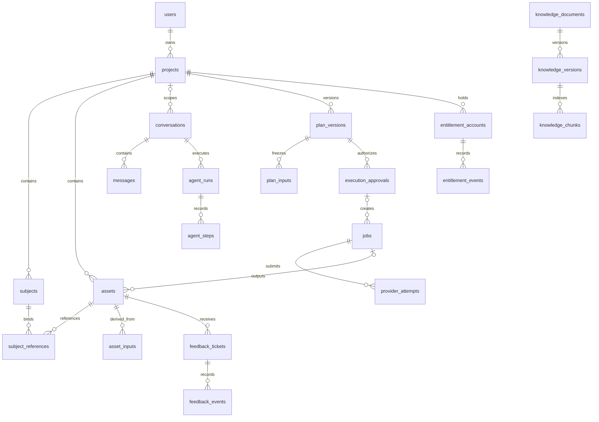

<!-- 文档职责：定义持久化事实、字段、约束、事务与恢复数据；字段为待实现契约，不是已执行迁移。 -->
# 映序 · 数据库设计

> 实施备注（2026-10-21）：用户已授权开始开发。本文保留设计目标和原审阅记录；实际完成范围、已验证项与差异见 [开发进度](./开发进度.md)，不能将目标目录或字段表视为全部已实现。
版本：V1.11 · 2026-10-22。状态：已获开发授权；目标表设计与分批实际迁移并存，当前新增字段见文末 V1.11。配套：[开发文档](./开发文档.md)、[项目结构](./项目结构.md)、[故障与清理](./runbooks/故障与清理.md)。

本设计使用一个 PostgreSQL 数据库和 pgvector，核心 25 张业务表；正式支付阶段增加 orders、payments、refunds 三张表。表较多是为了区分业务对象、流水和关联关系，不意味着拆成多个服务。本文件保留完整目标结构；已执行迁移按文末各版本记录，当前主库迁移头 d72ad49fe108，不能将目标表全部视为已实现。

## 1. 通用约定

- 标识主键默认 UUID；例外的复合主键在各表单独注明。所有表包含 created_at；可变记录还包含 updated_at，类型均为 timestamptz。
- 以下字段未写“可空”即默认 NOT NULL；有条件必填的字段由 CHECK、事务或触发器约束。FK 表示外键。
- 状态采用 text + CHECK，初期便于迁移；数量 integer、轮次/版本 bigint、金额整数分 bigint、内部成本 numeric(18,8) + currency。
- JSONB 仅用于规格、快照和可变元数据，应用层用版本化 Pydantic schema 校验；归属、状态、关键外键与可筛选字段独立成列。
- 用户照片、视频和知识原文保存在私有对象存储。数据库记录对象键，不长期保存签名 URL，不保存密钥。
- 一个项目 V1 只属于一个用户。两个人物不代表两名项目成员；共享协作后续另建成员表。
- 外键默认 RESTRICT/NO ACTION，避免删除项目时级联抹掉权益和审计。删除通过明确的异步清理流程执行。
- 跨项目关联优先使用 `(project_id,id)` 复合外键；跨行约束不能假装由普通 CHECK 完成，必要时通过锁定事务/触发器验证。
- 方案、流水等正常操作不可覆盖；隐私删除时允许受控擦除敏感载荷，保留必要 tombstone 和审计。
- 独立正文、说明、JSONB 都有应用层大小限制；列表查询不默认返回大快照。
- 表、列在迁移中提供 COMMENT；ORM/schema 字段说明包含语义、单位、空值和敏感性。迁移文件头及关键约束注释解释兼容、锁顺序和回退限制，遵循项目结构第 8 节。

## 2. 表清单与关系

| 分组 | 表 | 数量 |
|---|---|---:|
| 身份、项目与素材 | users、projects、subjects、assets、subject_references、asset_inputs | 6 |
| 对话与方案 | conversations、messages、agent_runs、agent_steps、plan_versions、plan_inputs、execution_approvals | 7 |
| 任务与投递 | jobs、provider_attempts、outbox_events、inbox_events | 4 |
| 权益 | entitlement_accounts、entitlement_events | 2 |
| 知识 | knowledge_documents、knowledge_versions、knowledge_chunks | 3 |
| 反馈 | feedback_tickets、feedback_events | 2 |
| 审计 | audit_logs | 1 |
| 核心合计 | | **25** |
| 商业化新增 | orders、payments、refunds | **3** |



图中只展示主要关系；例如 knowledge_index 是系统 Job，不关联 execution_approval。数据库完整约束以下文为准。

## 3. 身份、项目与素材

### 3.1 users

| 字段 | 类型 | 说明 |
|---|---|---|
| id | uuid PK | 用户 ID |
| phone_ciphertext | text，可空 | 加密手机号；删除账号后可擦除 |
| phone_lookup_hash | text，可空 | 服务器密钥 HMAC，用于查询/唯一性；非普通明文 hash |
| display_name | text | 昵称 |
| role | text | customer / staff / admin |
| status | text | active / blocked / deleting / deleted |
| last_login_at | timestamptz，可空 | 最后登录时间 |

非空 phone_lookup_hash 唯一；active 用户要求手机号字段完整。员工和管理员通过受控开通流程建立，不允许普通注册提交 role。会话、验证码存 Redis 且有 TTL；账户状态每次重要操作复核，删除时使会话失效。若后续加入多身份绑定，再增 auth_identities，不提前把微信 ID 塞进一个无约束 JSON。

### 3.2 projects

| 字段 | 类型 | 说明 |
|---|---|---|
| id / owner_user_id | uuid PK / uuid FK | 项目与拥有者 |
| client_request_key | text | 建项目幂等键，唯一范围为 owner_user_id |
| kind / title | text / text | wedding / portrait；用户标题 |
| lifecycle | text | active / archived / deleting / deleted |
| brief_json | jsonb | 当前需求，含 schema_version；不是已批准方案 |
| brief_revision | bigint | 初始 1，影响创作的需求/参考集变化时递增 |
| next_plan_version | bigint | 初始 1，锁项目后分配方案版本号 |
| privacy_epoch | bigint | 初始 0，授权撤销或敏感删除时递增 |
| privacy_cleanup_pending | boolean | 初始 false，清理期间禁止上下文和任务继续使用 |
| cleanup_state_json | jsonb | 默认带 schema_version 的 idle 状态；epoch、阶段、游标、错误和时间，见 13.3 |
| cleanup_next_attempt_at | timestamptz，可空 | 下次清理时间；待处理时必填 |
| cleanup_worker_id / cleanup_lease_until | text，可空 / timestamptz，可空 | 清理执行者及租约，成对为空或非空 |
| cleanup_attempt_no | bigint | 初始 0，每次领取递增；跨 epoch 不重置 |
| deleted_at | timestamptz，可空 | 删除时间 |

UNIQUE(id,owner_user_id)、UNIQUE(owner_user_id,client_request_key)。索引 `(owner_user_id,created_at DESC)`。归档不等于删除，也不自动释放运行中任务权益。

增加清理扫描索引 `(cleanup_next_attempt_at) WHERE privacy_cleanup_pending` 及清理租约索引。进度提交按 project_id + privacy_epoch + cleanup_attempt_no + worker_id 校验，不允许旧清理者解除新清理屏障。`cleanup_state_json` 不存照片/完整对话或不断增长的目标 ID 数组。

### 3.3 subjects

| 字段 | 类型 | 说明 |
|---|---|---|
| id / project_id | uuid PK / uuid FK | 人物和项目 |
| subject_key / display_name | text / text | person_a / person_b；界面显示名 |
| authorization_state | text | declared / revoked |
| declaration_version | text | 用户确认的使用声明版本 |
| declared_by / declared_at | uuid FK / timestamptz | 声明人和时间 |
| authorization_revision | bigint | 每次声明变化递增 |
| revoked_at | timestamptz，可空 | 撤销时间 |

UNIQUE(project_id,subject_key)、UNIQUE(project_id,id)。portrait 只允许 person_a，wedding 最多两人，由业务服务校验。声明代表上传者作出的授权声明，不表示系统完成了现实身份认证。

### 3.4 assets

| 字段 | 类型 | 说明 |
|---|---|---|
| id / project_id / owner_user_id | uuid PK / uuid / uuid | 文件版本、项目、用户 |
| logical_asset_id / version_no | uuid / integer | 同一逻辑资产的版本；首版可 logical_asset_id=id |
| kind | text | reference / base / style / photo / avatar / wallpaper / poster / montage / thumbnail |
| storage_key | text | 私有对象键 |
| checksum | text，可空 | 完成上传/生成后记录文件摘要 |
| mime_type / byte_size | text / bigint | 校验后的类型和大小；上传中可为预期值 |
| width / height / duration_ms | integer，可空 | 媒体规格 |
| status | text | uploading / ready / quarantined / deleting / deleted |
| source_job_id / output_slot | uuid FK，可空 / text，可空 | 生成来源与 primary/thumbnail 等输出槽 |
| metadata_json | jsonb | 可见渲染信息、尺寸等，不保存隐藏推理 |
| revision | bigint | 初始 1；状态/可见性变更递增，用于事件去重 |
| expires_at / deleted_at | timestamptz，可空 | 保留期与删除状态 |
| deletion_requested_at / deletion_epoch | timestamptz，可空 / bigint，可空 | 成对记录删除意图及所属项目隐私版本；删除完成后仍保留 |

UNIQUE(project_id,id)、UNIQUE(logical_asset_id,version_no)、UNIQUE(storage_key)、UNIQUE(source_job_id,output_slot)。source_job_id 和 output_slot 必须同时为空或同时非空。以 `(project_id,owner_user_id)` 约束项目归属；生成来源也必须同项目。ready 之前不能用于方案输入。

上传接口完成后服务端核实真实类型、大小、解码与尺寸，不能把客户端传来的 metadata 直接视为可信。新一轮生成/售后重做产生新资产，不覆盖原文件内容。

请求删除时先持久化 deletion_requested_at/deletion_epoch 并阻断访问，实际对象删除可异步；两字段成对为空或非空。按 project_id、status 和 deletion_epoch 查询清理目标；遍历血缘前不删除 asset_inputs、subject_references 或相关输入引用。保留最小 tombstone 供重试和迟到结果判断，区域/文件名等敏感载荷在目标确定后擦除。

### 3.5 subject_references

| 字段 | 类型 | 说明 |
|---|---|---|
| project_id / subject_id / asset_id | uuid | 同项目人物与具体参考图版本 |
| reference_key | text | 绑定槽，例如 front / side / extra_1 |
| sort_order | integer | 展示顺序 |
| region_json | jsonb，可空 | 合照中该人物区域，采用统一归一化坐标格式 |
| is_selected | boolean | 当前默认参考集是否选中 |

主键 `(subject_id,asset_id,reference_key)`；人物和资产都使用复合项目外键。限制同一人物同一 reference_key 的有效选择规则由服务校验。删除/取消选中这里只改变未来默认参考集；已确认的 plan_inputs 保留冻结清单。

### 3.6 asset_inputs

| 字段 | 类型 | 说明 |
|---|---|---|
| project_id | uuid | 项目 |
| asset_id / input_asset_id | uuid | 输出资产与使用的输入资产 |
| input_role | text | reference / source_photo / montage_frame |
| position | integer | 多图顺序 |

主键 `(asset_id,input_asset_id,input_role,position)`；两端以复合外键约束同项目，CHECK 两端不同。索引 `(input_asset_id)` 用于删除血缘反查。只允许新输出引用此前已存在的输入，不允许用户任意编辑关系，避免形成环。派生文件访问和隐私删除都使用这张血缘表。

## 4. 对话、运行和方案

### 4.1 conversations

| 字段 | 类型 | 说明 |
|---|---|---|
| id / owner_user_id | uuid PK / uuid FK | 会话及拥有者 |
| project_id | uuid FK，可空 | 项目范围；全站客服可为空 |
| entry_mode | text | auto / support_only |
| handoff_status | text | bot / requested / human |
| assigned_staff_id | uuid FK，可空 | 领取的员工 |
| status | text | open / closed |
| next_turn_no / next_message_seq | bigint | 下一个用户轮次和时间线序号 |

UNIQUE(id,owner_user_id)。项目非空时用复合 FK 保证拥有者一致。V1 明确：project_id 为空时仅允许 support_only；auto 创作会话必须关联项目。人工接管仅 support_only；human 时 assigned_staff_id 必填。

### 4.2 messages

| 字段 | 类型 | 说明 |
|---|---|---|
| id / conversation_id | uuid PK / uuid FK | 消息 |
| turn_no / seq | bigint / bigint | 所属用户轮次与显示序号；独立系统通知可 turn_no=0 |
| client_message_id | text，可空 | 用户/员工发送的客户端防重键 |
| role | text | user / assistant / staff / system |
| author_user_id | uuid FK，可空 | 用户/员工，assistant/system 可空 |
| content_json | jsonb | text、attachment IDs、plan 卡片等受控内容 |
| citations_json | jsonb | 默认 []；文档/版本/chunk/定位，不复制整篇原文 |
| source_run_id | uuid FK，可空 | 正式 Agent 回复来源 |
| is_final | boolean | 是否该 Run 的正式最终消息 |

UNIQUE(conversation_id,seq)、非空 UNIQUE(conversation_id,client_message_id)、UNIQUE(conversation_id,id)。`source_run_id WHERE is_final` 唯一。assistant 正式回复必须关联本会话 Run；程序通知使用 system。草稿 token 不逐条落 messages。

seq 控制 UI 排序；模型上下文按完整轮次读取。用户第二条消息可能先于第一轮助手回复写入，不能仅用“seq 小于当前用户消息”截断上下文而漏掉第一轮已完成回复。

### 4.3 agent_runs

| 字段 | 类型 | 说明 |
|---|---|---|
| id / conversation_id / trigger_message_id | uuid PK / uuid FK / uuid FK | 一次执行及触发消息 |
| turn_no | bigint | 对应用户轮次 |
| primary_role | text，可空 | creative / support；领取路由后确定 |
| intent_tags | jsonb | 例如 creative、quota_question |
| route_source | text，可空 | entry / rules / model |
| status | text | queued / running / succeeded / failed / cancelled |
| revision | bigint | 初始 1；用户可见状态变更时递增 |
| outcome | text，可空 | answered / needs_input / plan_ready / handoff |
| input_snapshot | jsonb | 消息范围、必要摘要、项目版本、素材引用、隐私版本 |
| config_snapshot | jsonb | Release、模型、提示词摘要、工具、编排代码和预算 |
| origin_request_id / trace_id | text，可空 / text，可空 | 原始入口请求与观测关联；恢复时保留，后续尝试可使用关联 span |
| attempt_no | bigint | 每次领取递增，执行隔离版本 |
| worker_id / lease_until | text，可空 / timestamptz，可空 | 执行租约 |
| deadline_at / cancel_requested_at | timestamptz，可空 | 总截止时间与取消请求 |
| model_call_count / tool_call_count | integer | 累计预算计数，技术接管不归零 |
| usage_json / estimated_cost | jsonb / numeric(18,8) | 汇总用量与估算成本，含币种信息 |
| error_code | text，可空 | 脱敏错误分类 |
| started_at / finished_at | timestamptz，可空 | 执行时间 |

UNIQUE(trigger_message_id)、UNIQUE(conversation_id,turn_no)、UNIQUE(conversation_id,id)。部分唯一索引 `conversation_id WHERE status='running'` 保证单会话最多一个运行中 Run。触发消息必须属于同会话且 role=user；该跨表条件由创建事务检查。

input_snapshot/config_snapshot 首次领取后冻结；最小必要敏感内容遵守清理策略。V1 不添加未使用的 checkpoint_thread_id；以后启用持久化检查点再做迁移。步骤和 Run 汇总不能重复计入成本报表。

### 4.4 agent_steps

| 字段 | 类型 | 说明 |
|---|---|---|
| id / run_id | uuid PK / uuid FK | 步骤 |
| attempt_no / step_no | bigint / integer | 所属领取版本与顺序 |
| kind / name | text / text | model / tool / route / validation；操作名 |
| request_key | text | 本次步骤关联键 |
| input_summary / output_summary | jsonb | 脱敏且限长的输入输出摘要 |
| context_manifest_json | jsonb，可空 | kind=model 时记录来源、版本、输入预算与裁剪清单，见 13.1 |
| trace_id / span_id | text，可空 / text，可空 | 当前步骤的调用链标识；不存敏感业务值 |
| status | text | running / succeeded / failed / skipped |
| duration_ms / usage_json | integer / jsonb | 耗时、token 等 |
| estimated_cost | numeric(18,8) | 与配置币种一致的估算成本 |
| error_code | text，可空 | 错误类别 |

UNIQUE(run_id,attempt_no,step_no)。不保存隐藏推理链、照片 Base64、Cookie、API Key、长期可用文件链接。模型调用前先占用预算；崩溃后不假定未收到结果的调用没有成本。

### 4.5 plan_versions

| 字段 | 类型 | 说明 |
|---|---|---|
| id / project_id | uuid PK / uuid FK | 不可变方案 |
| version_no / brief_revision | bigint / bigint | 项目内方案号与需求版本 |
| source_run_id | uuid FK，可空 | Agent 产出的方案；表单赠品可空 |
| client_request_key | text，可空 | 表单创建/修订的防重键 |
| created_by | uuid FK | 操作用户；由 Run 发起时为其用户 |
| kind | text | photo_set / image_edit / avatar / wallpaper / poster / montage |
| spec_json | jsonb | 风格 ID/版本、尺寸、数量、文案、模板与参数 |
| execution_policy_json | jsonb | 可用供应商、技术/生成重试上限、成本上限 |
| quota_snapshot | jsonb | 服务器计算的权益数量，如 photo=4 |
| input_manifest_hash / content_hash | text / text | 输入清单和整个执行内容的规范化摘要 |

UNIQUE(project_id,version_no)、UNIQUE(project_id,id)、非空 source_run_id 唯一、非空 UNIQUE(project_id,client_request_key)。冻结后不能覆盖 spec/输入/消耗；修订创建新版本。`image_edit` 仅在供应商能力通过验收后开放，不能因为预留枚举就展示可用按钮。

### 4.6 plan_inputs

| 字段 | 类型 | 说明 |
|---|---|---|
| plan_version_id / project_id | uuid | 方案与项目 |
| slot_key | text | 固定输入槽 |
| asset_id | uuid | 具体资产版本 |
| subject_id | uuid，可空 | 人物参考；视频成片输入可空 |
| subject_authorization_revision | bigint，可空 | 对应人物授权版本 |
| region_snapshot | jsonb，可空 | 人物区域的冻结值 |

主键 `(plan_version_id,slot_key)`。方案、资产、人物均使用同项目复合 FK；subject_id 非空时授权版本必填。不能存“人物最新参考图”作为动态输入。Job 输入只能从方案冻结清单中选择。

### 4.7 execution_approvals

| 字段 | 类型 | 说明 |
|---|---|---|
| id / project_id / plan_version_id | uuid PK / uuid / uuid | 执行确认与方案 |
| purpose | text | user_creation / feedback_remake |
| feedback_ticket_id | uuid FK，可空 | 仅售后补偿重做使用 |
| created_by | uuid FK | 发起人 |
| client_request_key | text | 创建确认单幂等键 |
| status | text | pending / accepted / expired / cancelled |
| plan_hash / quote_json | text / jsonb | 方案摘要及服务端权益/报价快照 |
| execution_scope_json | jsonb | 冻结的交付项范围；普通创作为全部，补偿为指定源 Job/交付项 |
| pricing_rule_version | text | 定价/权益规则版本 |
| expires_at | timestamptz | 待确认有效期 |
| accepted_by / accepted_at | uuid FK，可空 / timestamptz，可空 | 确认者和时间 |
| acceptance_key | text，可空 | 接受确认的幂等键 |

UNIQUE(project_id,id)、UNIQUE(project_id,client_request_key)、非空 UNIQUE(accepted_by,acceptance_key)。accepted 要求三个 accepted 字段非空，且权益预占/Jobs 已在同一事务完成。

user_creation 的 accepted_by 必须是项目拥有者，feedback_ticket_id 为空。feedback_remake 必须关联同项目、明确请求重做的有效工单；由有权员工接受、quote 中用户消耗为 0，并记录补偿成本政策。该权限不能由客户端 purpose 字段自行获得。

非空 feedback_ticket_id 唯一，第一版一个工单只有一次补偿执行；重复 API 请求返回既有确认和任务。补偿单只重做该工单对应的原交付项，不重新执行整组照片；execution_scope_json 冻结源 Job ID、item_key 和服务端核准的执行规格，不能接收员工任意修改的供应商参数。原人物授权、输入与隐私条件仍须有效。

普通用户确认要求方案对应当前 brief_revision。补偿明确重现旧交付项，因此允许原方案需求版本不是最新，但必须逐项复核原素材、人物授权、当前隐私状态与内部补偿政策；如需改创作要求，应另建用户方案。确认单中的方案、报价和执行范围创建后不可覆盖。

## 5. 任务、供应商提交与可靠投递

### 5.1 jobs

| 字段 | 类型 | 说明 |
|---|---|---|
| id / scope | uuid PK / text | project / system |
| project_id / owner_user_id | uuid，可空 | project 任务必填 |
| approval_id / item_key | uuid FK，可空 / text | 确认单和固定交付项编号 |
| knowledge_version_id | uuid FK，可空 | 系统知识索引目标 |
| created_by | uuid FK | 用户或管理员 |
| kind | text | image_generate / image_edit / avatar_crop / wallpaper_render / poster_render / montage_render / knowledge_index |
| input_snapshot / config_snapshot | jsonb | 冻结输入、输出参数、模板/供应商能力版本 |
| origin_request_id / trace_id | text，可空 / text，可空 | 创建入口和异步执行关联，不代替 Job 主键 |
| project_privacy_epoch | bigint，可空 | 项目任务接受时的隐私版本 |
| status | text | queued / running / waiting_external / retry_wait / needs_reconcile / succeeded / failed / cancelled |
| revision | bigint | 初始 1；用户可见状态/进度变更递增 |
| phase / progress_json | text / jsonb | 阶段与真实计数 |
| attempt_no | bigint | 每次领取递增，用于隔离旧 Worker |
| retry_count / max_retries | integer / integer | 已确认技术失败的重试次数与上限 |
| worker_id / lease_until / next_attempt_at | text，可空 / timestamptz，可空 / timestamptz，可空 | 领取和调度 |
| deadline_at / cancel_requested_at | timestamptz，可空 | 总期限与取消请求 |
| accepted_provider_attempt_id | uuid FK，可空 | 当前允许发布结果的供应商提交 |
| quota_code / quota_qty | text，可空 / integer | 该交付项的权益类型/数量 |
| quota_state / quota_settled_at | text / timestamptz，可空 | none / reserved / consumed / released；结算时间 |
| cost_limit / cost_summary_json | numeric(18,8) / jsonb | 内部预算与成本估计/确认值，含币种 |
| error_code / error_detail | text，可空 / jsonb | 分类和脱敏诊断 |
| started_at / finished_at | timestamptz，可空 | 时间 |

UNIQUE(project_id,id)、UNIQUE(approval_id,item_key)；knowledge_index 对 knowledge_version_id 部分唯一。索引 `(status,next_attempt_at)`、`(project_id,created_at)`、运行中 lease_until。

项目任务必填 project、owner、approval、privacy_epoch，无 knowledge_version_id。系统任务 V1 只允许 knowledge_index，要求 knowledge_version_id，且无项目/用户/approval、quota_state=none。accepted_provider_attempt_id 通过复合 FK 确保属于同一 Job。

普通项目 Job 每个只使用一种权益，通常 quota_qty=1；对应 quota_state 不能为 none。售后补偿 Job 的 approval 必须为 feedback_remake，quota_code 为空、quota_qty=0、quota_state=none，并接受独立成本上限；这项跨表规则由业务事务验证。

一张照片和其缩略图属于同一个 Job 的两个输出槽，完整满足交付要求才核销一次。不同照片分别建 Job，互不连带失败。

### 5.2 provider_attempts

| 字段 | 类型 | 说明 |
|---|---|---|
| id / job_id / submission_no | uuid PK / uuid FK / integer | 一次实际外部生成提交 |
| provider / provider_account_key | text / text | 供应商与逻辑账号，不是密钥 |
| client_request_key / request_hash | text / text | 提交前保存的稳定请求键与请求摘要 |
| provider_task_id | text，可空 | 供应商任务号 |
| status | text | prepared / submitting / submission_unknown / accepted / running / succeeded / failed / cancelled |
| request_snapshot / result_json | jsonb | 脱敏规格和结果引用 |
| estimated_cost / actual_cost | numeric(18,8) / numeric(18,8)，后者可空 | 成本估计与已确认值 |
| currency | char(3) | 成本币种 |
| next_reconcile_at / reconcile_deadline_at | timestamptz，可空 | 核对时间与人工升级期限 |
| submitted_at / finished_at | timestamptz，可空 | 时间 |

UNIQUE(job_id,id)、UNIQUE(job_id,submission_no)、UNIQUE(provider,provider_account_key,client_request_key)；同供应商账号下非空 provider_task_id 唯一。

查询/轮询和 Worker 重新领取不增加 submission_no。prepared 写入后，切换 submitting 并提交数据库事务，再发送请求。恢复时遗留 submitting 等同 submission_unknown；供应商“暂未查到”不等于确定没有受理。前一次结果未知时不得新建付费提交来碰运气。

### 5.3 outbox_events

| 字段 | 类型 | 说明 |
|---|---|---|
| id / event_key | uuid PK / text UNIQUE | 内部事件及逻辑去重键 |
| event_type / aggregate_type / aggregate_id | text / text / uuid | run.enqueue、job.enqueue 等 |
| payload_json | jsonb | ID、期望版本等最小信息 |
| status | text | pending / sending / sent / retry_wait |
| attempt_count / available_at | integer / timestamptz | 次数与下次投递时间 |
| locked_until / sent_at | timestamptz，可空 | 投递租约与发送时间 |
| last_error | text，可空 | 脱敏错误 |

索引 `(status,available_at)`。与创建 Run/Job 的业务事务一起提交。先向队列发送，后标记 sent；两步之间崩溃会重复发送，消费者仍必须幂等。恢复扫描发现长期 queued 且无有效执行租约时，可重新调度对应资源；不要因为旧 outbox=sent 就认为任务一定完成。

### 5.4 inbox_events

| 字段 | 类型 | 说明 |
|---|---|---|
| id / source / source_account_key | uuid PK / text / text | 来源和逻辑账号 |
| external_event_key | text | 官方事件号；没有时使用规范化指纹 |
| event_type / external_task_id | text / text，可空 | 回调类型与任务号 |
| client_request_key | text，可空 | 客户端关联键 |
| payload_json | jsonb | 验签后的必要事实，大小受限 |
| matched_attempt_id | uuid FK，可空 | 图片回调匹配到的提交记录 |
| status / next_attempt_at | text / timestamptz，可空 | received / unmatched / processing / processed / failed |
| received_at / processed_at | timestamptz / timestamptz，可空 | 收到与完成时间 |
| error_code | text，可空 | 错误原因 |

UNIQUE(source,source_account_key,external_event_key)。先验签，再持久化，持久化成功才向供应商确认收到。回调早于提交响应时允许 unmatched，后续匹配。

处理时在短事务内锁 inbox、写业务事实/必要 outbox 并置 processed。processing 不单独提前提交，崩溃回滚后即可重领；需要网络查询时交给核对任务，不持有事务等待网络。支付阶段也复用本表，图片 attempt 关联字段为空。

## 6. 项目权益

V1 权益属于项目，不跨项目转移，不分购买批次或单独过期。统一代码：photo、avatar、wallpaper、poster、montage。每种权益的尺寸/数量/时长边界写在目录配置，确认时快照保存。

### 6.1 entitlement_accounts

| 字段 | 类型 | 说明 |
|---|---|---|
| project_id / quota_code | uuid FK / text | 复合主键 |
| granted_qty | integer | 累计有效发放，已扣除正式撤回 |
| reserved_qty | integer | 生成预占；支付阶段还包括退款冻结 |
| used_qty | integer | 已交付核销 |

可用=`granted_qty - reserved_qty - used_qty`，不另存 available。CHECK 全部非负且 granted_qty≥reserved_qty+used_qty。预占时按 quota_code 排序锁行，防止多权益确认发生死锁。

### 6.2 entitlement_events

| 字段 | 类型 | 说明 |
|---|---|---|
| id / project_id / quota_code | uuid PK / uuid / text | 流水和对应账户 |
| event_type | text | grant / reserve / consume / release / revoke / refund_hold / refund_release |
| delta_granted / delta_reserved / delta_used | integer | 三个计数变化 |
| source_type / source_id | text / text | trial / admin_gift / order / job / refund 及业务键 |
| idempotency_key | text UNIQUE | 业务唯一键 |
| actor_user_id | uuid FK，可空 | 系统可空 |
| reason / metadata_json | text / jsonb | 原因、活动版本、必要快照 |

复合 FK 指向权益账户；索引 `(project_id,quota_code,created_at)`。追加写；账户变化、Job 的 quota_state 变化和流水必须同一事务。

| 动作 | delta_granted | delta_reserved | delta_used |
|---|---:|---:|---:|
| 发放 n | +n | 0 | 0 |
| 预占 n | 0 | +n | 0 |
| 成功核销 n | 0 | -n | +n |
| 失败/取消返还 n | 0 | -n | 0 |
| 撤回可用权益 n | -n | 0 | 0 |
| 退款冻结 n | 0 | +n | 0 |
| 退款成功撤回 n | -n | -n | 0 |

最后一项记为带 refund 来源的 revoke，区别于普通撤回。refund_release 用于退款失败解冻 `(0,-n,0)`。每种事件验证来源与合法增减组合。

试用防重键按活动版本+用户+权益代码，例如 `trial:v1:{user_id}:photo`，不能只按项目，否则用户可反复建项目领试用。后台赠送使用稳定操作 ID，流水记录操作者和原因。

## 7. 知识库

### 7.1 knowledge_documents

| 字段 | 类型 | 说明 |
|---|---|---|
| id / source_key | uuid PK / text UNIQUE | 稳定文档身份 |
| title / category | text / text | product / photography / wedding 等 |
| summary | text | 指南目录摘要，禁止包含未发布私密内容 |
| published_version_id | uuid，可空 | 当前发布版本，空表示未发布/下架 |
| revision | bigint | 每次发布或下架递增 |
| created_by | uuid FK | 管理员 |

`(id,published_version_id)` 复合 FK 指向 knowledge_versions(document_id,id)，不能指到别的文档。指南页面只展示有有效发布指针的文档；更新标题/摘要属于受控发布变更，不能把未发布草稿元数据泄漏到指南。

### 7.2 knowledge_versions

| 字段 | 类型 | 说明 |
|---|---|---|
| id / document_id / version_no | uuid PK / uuid FK / integer | 版本 |
| client_request_key | text | 导入幂等键，文档内唯一 |
| source_object_key / content_hash | text / text | 私有原文与摘要 |
| status | text | processing / ready / failed |
| pipeline_version / embedding_spec | text / jsonb | 解析/分词/分块版本、模型/维度/规范化参数 |
| chunk_count | integer | 完成块数 |
| approved_by / approved_at | uuid FK，可空 / timestamptz，可空 | 人工批准信息 |
| valid_from / valid_until | timestamptz / timestamptz，可空 | 生效与到期 |
| revoked_at / error_code | timestamptz，可空 / text，可空 | 撤销和错误 |

UNIQUE(document_id,version_no)、UNIQUE(document_id,id)、UNIQUE(document_id,client_request_key)。有效期结束晚于开始。ready 后正文/块/向量不可修改，改文档产生新版本。发布指针可引用的版本必须 ready、已批准、未撤销且在有效期内。

### 7.3 knowledge_chunks

| 字段 | 类型 | 说明 |
|---|---|---|
| id / version_id / ordinal | uuid PK / uuid FK / integer | 片段与顺序 |
| content / text_hash | text / text | 正文和摘要 |
| locator_json | jsonb | 页码、章节与段落 |
| embedding | vector(d) | d 是选定模型维度，首次迁移前确定 |
| search_vector | tsvector | 应用中文分词后构建的关键词索引 |
| token_count | integer | 上下文预算参考 |

UNIQUE(version_id,ordinal)，索引 version_id、GIN(search_vector)。`vector(d)` 是设计记法，迁移时必须写成已确定的整数维度，不可原样执行。第一版固定 embedding 空间；以后换模型需重建和验证，不能仅改模型名称。

V1 不使用所有历史块直接检索后再凭提示词过滤。查询必须在数据库可见版本范围内执行；下架/撤销不因旧缓存继续被引用。引用保存在 messages.citations_json，查看来源必须验证用户有权读取该消息。

## 8. 作品反馈

### 8.1 feedback_tickets

| 字段 | 类型 | 说明 |
|---|---|---|
| id / project_id / owner_user_id | uuid PK / uuid / uuid | 工单与归属 |
| asset_id | uuid | 用户反馈的特定成片版本 |
| client_request_key | text | 用户提交幂等键 |
| category | text | likeness / visual / style / file |
| requested_action | text | redo / support |
| description | text | 用户问题说明 |
| status | text | new / in_progress / resolved |
| revision | bigint | 初始 1；状态、回复或授权发生变更时递增 |
| assigned_staff_id | uuid FK，可空 | 经办人 |
| view_consent | boolean | 默认 false，仅针对 asset_id 对应成片 |
| consent_revision | bigint | 每次变更递增，下载授权时复核 |
| consent_granted_at / consent_revoked_at | timestamptz，可空 | 授予/撤销时间 |
| resolved_at | timestamptz，可空 | 结单时间 |

UNIQUE(project_id,id)、UNIQUE(owner_user_id,client_request_key)。部分唯一索引 `asset_id WHERE status IN ('new','in_progress')`，同一成片最多一个活动工单。项目、资产、拥有者用复合 FK 约束，reference 不允许作为普通作品反馈对象。

view_consent 不保存图片副本，也不代表允许查看 subjects 或原始参考图。status=resolved 时强制 view_consent=false；授权撤销和结单要同时写事件和审计。需要后续再次反馈可新建工单，原已关闭时间线保留。

售后重做关系通过 execution_approvals.feedback_ticket_id 查询，任务状态直接从 Job 取得，不在工单再存一份容易失真的 redo_state。重做未终结时不结单；问题尚无回复且无已完成补偿时不允许无说明结单。

### 8.2 feedback_events

| 字段 | 类型 | 说明 |
|---|---|---|
| id / ticket_id | uuid PK / uuid FK | 时间线记录 |
| seq | bigint | 工单内严格顺序 |
| actor_type / actor_user_id | text / uuid FK，可空 | user / staff / system |
| event_type | text | submitted / user_message / reply / assigned / consent_changed / remake_requested / remake_completed / resolved |
| client_request_key | text，可空 | 用户/员工动作的防重键 |
| visibility | text | customer / internal |
| payload_json | jsonb | 文本、授权变更、approval/job 引用；禁止签名 URL 和密钥 |

UNIQUE(ticket_id,seq)、非空 UNIQUE(ticket_id,client_request_key)。锁工单后分配 seq。用户 API 只能返回 visibility=customer 的事件；内部诊断不可通过通用详情接口泄漏。访问授权始终读取当前工单，不依赖旧事件中曾经同意过。

## 9. audit_logs

| 字段 | 类型 | 说明 |
|---|---|---|
| id | uuid PK | 审计记录 |
| actor_type / actor_user_id | text / uuid FK，可空 | user / staff / system |
| action / resource_type / resource_id | text / text / text | 动作和资源 |
| project_id / request_id | uuid，可空 / text | 项目与请求关联 |
| before_summary / after_summary | jsonb | 最小脱敏差异 |
| reason / occurred_at | text / timestamptz | 原因和时间 |

索引 `(project_id,occurred_at)`、`(resource_type,resource_id,occurred_at)`、`(actor_user_id,occurred_at)`。追加记录：授权/撤销、执行确认、权益操作、知识发布下架、人工接管、查看授权成片、补偿重做、取消、异常核对、隐私删除以及后续退款。

不把照片本体、手机号明文和完整对话复制到审计。审计保留期和敏感擦除流程需上线前明确。

## 10. 正式支付阶段增加的表

内测阶段不创建假订单填充后台。实际支付模块上线时再迁移以下三表；订单金额来自版本化套餐快照。

### 10.1 orders

| 字段 | 类型 | 说明 |
|---|---|---|
| id / order_no | uuid PK / text UNIQUE | 订单 |
| owner_user_id / project_id | uuid / uuid | 买家与权益发放项目 |
| client_request_key | text | 买家范围内唯一 |
| package_code / package_version / package_snapshot | text / text / jsonb | 购买内容与发放权益快照 |
| amount_due_minor / currency | bigint / char(3) | 应付金额，整数分 |
| status | text | pending_payment / fulfilled / closed / review_required / refunded |
| fulfilled_payment_id | uuid FK，可空 | 唯一履约支付 |
| paid_at / fulfilled_at / expires_at | timestamptz，可空 / timestamptz，可空 / timestamptz | 时间 |

UNIQUE(owner_user_id,client_request_key)。订单项目归属校验，已下单套餐内容不可被后来目录修改影响。付款成功、grant 流水和 fulfilled 同一事务提交；已关闭订单迟到支付需要核对而非静默丢弃。

### 10.2 payments

| 字段 | 类型 | 说明 |
|---|---|---|
| id / order_id | uuid PK / uuid FK | 一次支付尝试 |
| provider / merchant_account_key | text / text | 通道及商户逻辑账号 |
| merchant_payment_no | text | 本方稳定支付请求号 |
| provider_transaction_id | text，可空 | 通道交易号 |
| status | text | created / pending / succeeded / failed / closed / needs_reconcile |
| amount_minor / currency | bigint / char(3) | 实际支付金额 |
| paid_at | timestamptz，可空 | 支付时间 |
| verified_event_id | uuid FK，可空 | 验签后的 inbox 事件 |

商户范围 merchant_payment_no 唯一；非空 provider_transaction_id 按通道/商户唯一。多个支付尝试可以属于同一订单，但只能一笔发放权益；额外成功支付进入 review_required 人工处理。

### 10.3 refunds

| 字段 | 类型 | 说明 |
|---|---|---|
| id / order_id / payment_id | uuid PK / uuid FK / uuid FK | 退款及原订单/支付 |
| request_key | text UNIQUE | 稳定退款请求键 |
| provider_refund_id | text，可空 | 通道退款号，按通道账号核验唯一性 |
| amount_minor | bigint | 本次退款金额 |
| quota_hold_snapshot | jsonb | 冻结的项目权益数量及规则版本 |
| status | text | requested / submitting / pending / succeeded / failed / needs_reconcile |
| requested_by / reason | uuid FK / text | 获授权操作员和原因 |
| requested_at / completed_at | timestamptz / timestamptz，可空 | 时间 |

支付必须属于该订单；退款总额不得超过原成功支付可退余额，锁订单/支付后检查。正式退款之前冻结对应未使用权益，成功时撤回，失败时解冻；提交超时保持待核对，不重复盲发。

V1 权益未按购买批次分摊，不能宣称支持精确批次退款。商业化初期采用明确的人工退款规则；需要自动按批次部分退款时，必须先补权益批次和消费分配模型。

## 11. 状态机与事务边界

### 11.1 Run

```text
queued → running → succeeded / failed / cancelled
queued → cancelled
running → running（租约过期后受控接管，attempt_no 递增）
```

claim、心跳和最终提交均校验 worker_id + attempt_no；租约到期的旧 Worker 不可发布。新用户消息创建新 Run，不能通过把已完成 Run 改回 running 来重放副作用。

### 11.2 Job

```text
queued → running
running → waiting_external / retry_wait / needs_reconcile / succeeded / failed / cancelled
waiting_external → running / needs_reconcile
retry_wait → running
needs_reconcile → running（取得核对结果后，再决定交付或终结）
queued / retry_wait → cancelled（确认未存在未决外部提交时）
```

外部回调保存事实并唤醒任务；发布文件和结算权益由有执行资格的处理者完成。waiting_external 不占用长时间 Worker。用户取消先写 cancel_requested_at，界面显示取消处理中，不能提前假定供应商停止。

技术重试 retry_count、Worker 领取 attempt_no、供应商付费提交 submission_no 是三种不同计数。自动重试不得重置总期限或无限增加外部生成次数。

### 11.3 必须原子执行的用例

| 用例 | 同一个数据库事务包含 |
|---|---|
| 用户发消息 | 按用户/项目（如有）/会话顺序加锁、检查待处理上限、分配轮次/seq、message、Run、outbox |
| Run 完成 | 检查执行权/版本、可选 brief 更新、plan/inputs/approval、最终 message、Run 终态 |
| 用户确认 | 按用户/项目/approval/权益顺序加锁、检查待处理上限、接受确认、预占流水、Jobs、outbox |
| 交付 | 校验当前 Job/供应商尝试/隐私、Assets/血缘、Job 成功、权益核销、通知 outbox |
| 失败/取消终结 | Job 状态转换、预占释放、流水、通知 |
| 赠送/撤回 | 权限、账户计数、唯一流水、审计 |
| 发布知识 | 文档 revision、版本资格、发布指针、审计 |
| 售后重做 | 按项目拥有者/项目/工单顺序加锁、检查待处理上限与原输入、补偿 approval、单个 Job、outbox、事件与审计 |
| 隐私撤销 | 锁项目、递增 epoch、阻断访问、请求取消、清理事件、审计 |
| 实际收款履约 | 验证支付事实、锁订单、支付记录、唯一发放流水、订单 fulfilled |

外部 HTTP、文件下载、FFmpeg、LLM 和 embedding 不在长事务内等待。固定锁顺序见 13.4，跨多个权益账户按 quota_code 排序。遇到死锁允许有限重试整个尚未产生外部副作用的事务。

### 11.4 幂等和并发最低约束

1. 重复消息：conversation_id + client_message_id 唯一，返回原 Run。
2. 重复方案：source_run_id 或 project_id + client_request_key 唯一。
3. 重复确认：approval 的 accepted 状态、acceptance_key 与 plan_hash；相同确认重试先返回既有结果，再考虑过期检查。
4. 重复任务：approval_id + item_key 唯一。
5. 重复供应商请求：稳定 client_request_key；未知提交不产生新 submission_no。
6. 重复回调：inbox 唯一键；处理还必须遵守 Job 状态机。
7. 重复发布：source_job_id + output_slot 唯一；所有权与 privacy_epoch 再核验。
8. 重复扣权益：quota_state 条件转换 + 唯一流水键，同一事务。
9. 重复补偿：feedback_ticket_id 唯一，最多一份补偿确认和对应交付项。

这些提供可重试、效果不重复的业务行为，不宣称所有外部系统能实现分布式“恰好执行一次”。

## 12. 迁移与验证顺序

建议按实现阶段组织迁移，编号在实际创建时生成：

1. 基础 schema、users、projects、subjects、assets、引用/血缘、权益。
2. conversations/messages、Run/steps、方案/确认；循环外键后补。
3. jobs/provider_attempts、inbox/outbox；补 assets.source_job_id 等外键。
4. 知识表与 pgvector、系统 Job 的知识外键；embedding 维度确定后建列。
5. feedback 与 audit；补 execution_approvals.feedback_ticket_id、复合/部分唯一索引。
6. 正式支付阶段追加三张支付表与相关外键。

实际迁移可将依赖紧密的表合并进同一 revision，先创建表再添加循环引用约束。审计模型在需要记录业务操作的阶段就应建立，上述分组不是要求推迟审计实施。

验收重点：真实 PostgreSQL 下测试两个并发确认只扣一次/不会负数；重放回调不重复出图；旧 Worker 不可完成新租约任务；隐私撤销后迟到成功不能发布；售后授权关闭时管理员也无法通过普通接口取图；删除原始素材后派生文件访问被阻断。

迁移上线前备份并验证。生产采用向前兼容的扩展/回填/切换/清理步骤；不把可能丢数据的降级脚本视为默认回滚方式。

## 13. V1.1 补充数据契约

本节复用现有 25 张表，未增加 Registry、Memory、评测或通用 Action 表。以下 JSONB 必须有 schema_version、Pydantic 校验和大小上限；扫描/领取字段独立成列，不用解析任意 JSON 代替调度索引。

### 13.1 每次模型调用的上下文与执行证据

agent_runs.input_snapshot 保存首次领取冻结的业务输入范围；agent_steps.context_manifest_json 保存每次模型调用实际选入的来源清单，二者不是同一份可变状态。

| 内容 | 最小字段与约束 |
|---|---|
| 来源范围 | source_type、source_id、source_revision/摘要；消息用 conversation_id + seq/turn 范围；不得跨授权项目 |
| 构建策略 | context_policy_version、摘要覆盖范围/摘要版本（若使用）、工具契约版本 |
| 容量 | 模型窗口、输入估算、输出预留、安全余量、各类输入估算；全部非负 |
| 裁剪证据 | 被移除/截断的类别、原因、保留的引用；不记录被移除的敏感原文 |
| 生效指纹 | 模型配置、提示词、工具和来源组合的规范化摘要；不是输出可完全复现的保证 |

必须保证来源清单有界；大结果仅保存私有引用，读取时重新鉴权。manifest 本身不授予资源访问权。相关素材删除后擦除敏感摘要和可还原载荷，保留必要的脱敏版本和失败原因。

agent_steps 的 input_summary/output_summary 定义按 kind 区分的版本化 schema：工具步骤记录 tool_version、参数摘要、结果类别、观察时间、是否允许重试及脱敏引用；模型步骤记录实际 provider/model/可用版本标识、调用参数摘要、停止原因和输出校验结果。重复无进展检测使用规范化工具名/参数/观察结果，不向模型或用户泄漏内部凭证。

### 13.2 Release、调用尝试和成本口径

Run/Job.config_snapshot 至少包含 release_id、release_digest、代码/镜像摘要、契约 schema_version、模型配置/允许的备用候选、提示词/工具/上下文/检索策略、模板/目录版本及预算。实际适用项必填，不适用项明确为空；敏感配置只保存逻辑凭证标识，不保存凭证值。第一次领取后冻结 Run 配置；Job 在确认事务冻结执行规格，后续不得按最新目录重算。

Release 文件受 Git 版本管理，不另建动态发布表；评测集和基线定义受版本管理，受控报告记录 dataset_version、evaluator/rubric_version、baseline_release、candidate_release、逐题结果、成本/时延、关键失败及审核结论。含敏感内容的报告不直接提交 Git，授权和保留期必须明确。

一次逻辑模型步骤包含多次真实供应商尝试时，必须在有界 usage_json.attempts 中逐次记录 attempt_key、provider/account_key、model、request_id（如有）、时间、状态、实际 token 或 unknown、estimated_cost/actual_cost 及币种。尝试数受 Release 预算限制；每次发送前先持久化尝试和占用调用预算。输入摘要不存完整请求体；外部响应未收到时不把成本当作零。图片付费尝试仍由 provider_attempts 独立承载，不混入模型步骤账目。

agent_steps / provider_attempts 是细项来源，Run/Job 汇总是便于查询的派生统计；同一报表只选一层聚合，不能重复相加。估算与实际值分别保留，不同币种不得直接相加；如展示换算，记录汇率来源/时间。业务次数权益仍由 entitlement_accounts/events 决定。

V1 的共享速率/并发许可放 Redis，带 owner、过期和释放规则；未知供应商任务以数据库记录核对。Redis 丢失后先从未决业务记录保守重建准入状态，不立即恢复无限新调用。这里没有持久化跨任务金额预占账本，因此不宣称严格金额硬上限；需要该能力时再专项设计。

### 13.3 可恢复的隐私清理

清理目标由持久业务标记推导：项目 deleting、subjects.revoked、assets.deletion_requested_at/deletion_epoch 及保留的输入/血缘关系。新的删除请求须先在短事务内写入目标标记；批量派生目标由清理扫描逐步发现并标记，不将完整 ID 列表塞进项目 JSON。

cleanup_state_json 包含：schema_version、epoch、status（idle/pending/running/retry_wait/blocked/completed）、stage（discover/erase/verify/done）、当前批游标、阶段计数、retry_count、脱敏 last_error_code、started_at/completed_at。游标仅为优化，断点恢复仍检查目标标记；不能跳过新加入的目标。

1. 发起：锁项目，递增 privacy_epoch，设 privacy_cleanup_pending=true；合并持久目标，重置当前 epoch 的阶段/游标/重试计数、清空旧租约，写下一次时间、取消请求、唯一清理 outbox 和审计。cleanup_attempt_no 保持单调；账户删除对每个项目发起同一流程。
2. 领取：扫描 pending、retry_wait 或租约过期项目，在短事务中检查资格并递增 cleanup_attempt_no，设置执行者和租约。blocked 保持访问屏障，恢复须通过受控操作。
3. 执行：按血缘标记所有受影响资产，并清理对象、附件、派生文件、上下文快照、临时文件和获授权评测副本。网络/文件操作在事务外，重复删除已不存在对象按成功处理；不能先删除血缘再计算目标。
4. 提交：每批进度必须校验当前 epoch + attempt_no + worker_id 和有效租约。新撤销到达时旧执行者不能清除屏障或覆盖游标；重置后的扫描从持久目标重新合并范围。
5. 完成：确认当前 epoch 全部目标处理完毕、相关可恢复快照/摘要已擦除、对象和授权凭证满足失效策略、旧执行结果无法再发布，才置 completed 并解除 pending。删除项目继续保持 deleted/不可访问，不因解除 pending 恢复。外部未决成本/取消仍由任务核对流程继续跟踪，不能为了结束清理强行宣告供应商已取消。

privacy_cleanup_pending=true 时 cleanup_next_attempt_at 必填；blocked 的该时间仅用于运维复核提醒，自动领取跳过。completed/idle 清空调度时间与租约。失败使用有上限的自动重试，超限进入 blocked 并告警，禁止直接把 pending 改 false。管理恢复必须记录原因，重新校验标记、epoch 和租约。

未撤销项目资源的可见性恢复前必须验证清理完成条件；保留敏感输入删除后的血缘 tombstone，防止以后重签派生文件链接。短期签名 URL 的立即失效能力取决于存储/代理策略，状态未达到约定失效条件不能声称彻底撤销。

迟到供应商结果只能写入受控临时命名空间或直接丢弃，发布事务复核隐私 epoch；无法发布的对象交给独立孤立对象扫描。临时对象使用任务/尝试标识和创建时间，扫描避开有效执行租约并设置安全宽限，防止误删正在交付的对象。备份恢复必须重放保留的删除/撤销清单，完成隐私复核后才开放访问，见故障与清理手册。

### 13.4 并发准入、恢复与验证补充

- 同一用户新建 Run/Job 的准入事务在计数和写入前锁定项目拥有者/会话用户的用户行，固定锁顺序为用户 → 项目 → 会话/工单 → 确认单 → 按 quota_code 排序的权益；同层多对象按稳定 ID 排序。已经存在的幂等结果先返回，不被新的容量上限阻断。其他组合用例获取这些锁时遵循同序，不先拿项目锁再补拿用户锁；Job、inbox 等新增锁的位置须在具体用例实现前补入统一锁序并做并发测试。
- 待处理数从数据库非终态 Run/Job 计算，不能只数 Redis 消息；权益预占与任务创建仍为同一事务。全局队列容量属于保守准入保护，精确全局硬上限需要单独的原子协调，不能把并发 COUNT 当作硬保证。
- 清理维护操作不新增 jobs.kind；V1 jobs 的 system 范围仍仅 knowledge_index，清理的业务进度归 projects，投递归 outbox。
- 验收增加：两个清理 Worker 竞争、清理中新增撤销、删除对象后进度提交失败、迟到文件、Redis 许可丢失、同用户跨项目并发提交、旧版本任务恢复和敏感评测副本清理。


## V1.3 当前实现补充

四种创作方式沿用已有 plan_versions.spec_json / input_manifest JSON 列和 assets.kind 字符串列，无新 DDL。新方案 schema_version=2，增加 mode、逐交付项 items（底图/人物/风格）、人物对应、套系镜头摘要与明确选用的资产 ID。Asset kind 新增 base/style；私有资产保持项目归属，人物参考另有 subject_id。AssetInput 只记录单项实际使用的私有输入，读取检查完整祖先血缘，连续编辑仍受原始授权撤销约束。公开套系图片来自可信配置，不伪造为用户上传 Asset。schema 1 历史方案及旧动作键保持兼容。详细字段以生成的 OpenAPI 与[四种创作方式接入](四种创作方式接入.md)为准。

## V1.4 当前实现补充

M1 迁移 da3987b1b6c4 扩展 provider_attempts：request_key（唯一，旧值由 job_id 回填）、account_scope（索引，旧值由 provider_id 回填）、upstream_task_id、error_code、next_poll_at、lookup_lease_until、finished_at、latency_ms、usage_json、estimated_cost_micros/estimated_currency、actual_cost_micros/currency。每项交付仍只允许一个生成尝试，查询不新增尝试。费用为 bigint 微单位，缺费用为 null，估算和确认币种独立保存；不落原始请求/图片/响应或结果 URL。

新增 runtime_gates（不计入前述目标 25 表）：scope 主键、分钟窗口与提交计数、连续失败计数、paused_until、retry_after_until。熔断与供应商退避独立，另一在途任务成功不能提前清除 Retry-After。账号行在保存 submitting 尝试前协调共享容量；submitting/pending/unknown 均计入在途，本地租约到期不释放。queue 行在确认事务中串行化全局/用户容量检查，事务失败回滚所有权益和 Job 变更。

本阶段已实现锁序为：确认 Project→Approval→queue gate→Account；执行/交付 Job→Project→provider gate→Account（失败路径可省略不需要的锁）。查询先锁 Job 保存有界租约，网络调用不持事务；返回后重新锁定并复核终态。没有引入用户锁或跨系统金额预占，未来 Run/会话与清理扩展须重新合并锁序后实现，不能机械混用前文目标锁序。SQLite 以 BEGIN IMMEDIATE 串行写用于本地；PostgreSQL 验收覆盖跨项目并发准入/共享账号与查询竞争。

回退迁移会移除接单凭据和费用字段。维护前停止派发、备份并排空在途/未知任务，优先前向修复；不能以丢失凭据后的旧表自动重发。详细行为见 [M1 供应商与任务恢复](M1供应商与任务恢复.md)。

## V1.5 后台模型发布

迁移 a06b4bffb961 添加 model_releases（id、created_at、actor_id、唯一 revision、白名单 settings_json、服务端编译 providers_json、routes_json）和 model_setting_heads（key 主键、revision、release_id 外键）。不改写原业务表。密钥值不进入 JSON；只有固定服务端凭证变量名。旧发布定义不可被新表单覆盖，已批准任务仍通过既有 provider_id 找到冻结模型。

发布锁序为 model-settings 协调行→head→新 release/审计；表单 expected_revision 必须匹配。验证构造插件不发外部请求，成功后发布指针和审计同事务提交。相同内容不增加版本。图片插件 ID 由图片定义独立摘要生成，修改 LLM 不使图片提案无故失效。

API 与 Worker 在使用网关时读取指针；指针变化后装配历史定义与当前路由，保留旧任务。数据库/配置验证失败时关闭新调用，不回退开发插件继续执行。回退新表会丢失历史定义，因此有相关在途/待核对任务时不允许按常规部署回退，优先前向修复。

## V1.6 创作会话与短 Run

迁移 b9ff639728f2 添加 conversations（项目唯一、next_seq）、messages（会话/Run ID、唯一会话序号、角色/正文、privacy_epoch、白名单 proposal_json）、agent_runs（唯一会话/client_message_id、request_hash、状态/阶段/outcome、brief_revision/privacy_epoch、模型/配置/预算/上下文/来源快照、累计 calls/数值 usage、account_scope、lease_token、call_until、总 deadline、终态时间）。当前 Message.run_id 保存受业务约束的 Run ID 和索引；会话/项目有外键。不复制照片、对象键或隐藏推理。

每项目一创作会话，入队即冻结，不允许同会话有多个未完成 Run；Project→Conversation→Run→必要 gate 锁序。网络调用在事务外；调用前记预算，最终提交复核版本/隐私/执行 token/取消/账户/素材。Run 即可靠投递意图，由调度器扫描 queued；运行崩溃不自动再次付费。call_until 使取消后的在途调用继续占并发直至回包或期限。真实金额无凭证，不推算为实付。

隐私代次不同的消息/Run 立即不再可见和参与上下文，维护进程清除其正文/建议/上下文。当前快照只返回最近 60 条消息、30 个 Run；上下文只取最近配置数量的完整成功轮次。目标设计中的通用 Step、客服、SSE、长期 brief 与完整分页未落地；详细差异见 [M2 创作 Agent](M2创作Agent.md)。

## V1.7 项目记忆与工具证据

迁移 ffba47dfea56 新增 project_memories：project_id 主键/外键、revision、privacy_epoch、requirements_json、confirmed_by_user_id、updated_at、cleared_at、history_cutoff_at。确认/编辑/清空使用项目锁及 revision 校验，删除要求记录历史上下文截止时间，防止旧对话恢复已遗忘内容；不改变已冻结图片方案。审计只记版本与条数。

agent_runs 添加 memory_revision、tool_calls、tool_trace_json，旧行回填 0/空数组后移除临时默认；messages 添加 nullable memory_suggestion_json、observations_json。查询次数在执行前持久化，最终回复绑定本轮查询来源。工具网络/写入能力均不开放，读取使用额外数据库只读事务；结果包含观察时间，不以历史数值充当当前事实。记忆更新使旧上下文 Run 失去提交权。

隐私代次变化立即屏蔽旧记忆和证据，维护清除正文、上下文和工具 JSON。旧记忆的物理清除不改变已生效的空记忆版本。具体接口、预算、并发与迁移验证见 [项目记忆与只读工具](M2项目记忆与只读工具.md)。

## V1.9 原生回复的临时字段

迁移 a38f94cce1d2 在 agent_runs 新增可空 JSON stream_json，保存当前调用尝试的 run_id/attempt_no/seq/text/privacy_epoch；最多1200字符，只保留最新前缀，不进入历史上下文。旧记录为 null。终态 Message 与 Run 同事务落库并清除此字段；取消/失败/超时/隐私清理也清除。客户端 RunView 的 reply_preview 仅在 running 时公开，不能代替正式 Message 或提供生成许可。

## V1.10 创作需求卡与历史分页

迁移 c64d48a13be9（前置 a38f94cce1d2）新增 project_memories.fields_json，旧行回填空对象后去除临时默认；messages 新增可空 brief_suggestion_json，保存最终校验的候选字段修改。沿用记忆 revision/privacy_epoch/history_cutoff_at，不建立第二份要求或隐式转换旧自由文本。审计只记录版本与条数。

确认字段和自由要求同事务更新；字段替换/删除与自由要求删除推进历史截止时间，普通上下文和历史工具使用同一边界。隐私清理同步清除字段及候选建议。消息分页沿用 conversation_id/seq 顺序和当前 privacy_epoch，签名游标绑定项目/代次/最早序号；用户手动浏览旧聊天不受遗忘截止时间隐藏。详情见 [第五批说明](M2创作需求卡与历史管理.md)。

## V1.11 M2全量持久化

迁移d72ad49fe108新增knowledge_documents/knowledge_versions/knowledge_chunks、独立knowledge_index_jobs及agent_steps。当前向量为经实际请求验证的Qwen3-Embedding-8B 1536维MRL空间；PostgreSQL使用vector(1536)，SQLite开发为JSON。发布文档/版本复合FK防止跨文档指针，当前发布资格在检索、最终消息和来源查看分别复核。系统索引任务不使用照片权益/图片Job。

conversations保留原project_id单创作会话唯一列并允许空，新增owner_user_id、context_project_id、scope_key、entry_mode、handoff_status、assigned_staff_id、revision；support_only可无项目。agent_runs新增owner_user_id、primary_role、release_json并允许无项目；旧行回填creative与空历史Release。messages增加citations_json、actor_id和会话内唯一client_message_id；员工消息不伪造AgentRun。人工请求与取消在同事务撤销自动提交权，call_until仍保留远端槽。

AgentStep包含seq/kind/name/status、来源Manifest/用量/错误与时间；只保存公开调用证据。项目隐私清理覆盖原Run内容、步骤摘要及无Run的人工消息。SQLite父表重建在显式事务内暂关本迁移连接FK、校验后提交；存在独立客服记录时拒绝有损降级，不自动删数据。完整约束和兼容说明见[完整M2说明](M2完整交付与验收.md)。


## M2.5 已实现的增量（2026-10-23）

本节记录实际新增 schema；前文长期目标表不因此全部视为实现。迁移链 `d72ad49fe108 → f14b2a5e0610 → f25b09310a11`。

| 表 | 所有者与约束 |
| --- | --- |
| `studio_drafts` | projects 模块；项目主键唯一，保存私有 `draft_json`、`revision` 和 `privacy_epoch`。项目行锁下比较期望版本，完整相同内容不递增。旧隐私代次内容立即不返回，维护清理正文。 |
| `model_candidates` | operations 模块；候选配置、代码/目录/参数摘要、逐能力证据、审批人及对应发布。保存不切换 `model_setting_heads`；批准后使用现有不可变 `model_releases`。 |
| `quality_feedback` | operations 模块；原成片唯一，额外参考最多一张；隐私代次、授权、状态、领取人、版本、审核记录及唯一补偿 Plan 引用。项目→工单锁序控制领取、撤回和一次补偿。 |

补偿复用 `plans`/`execution_approvals`/`jobs`，在冻结规格中记录反馈与来源成片，单个原交付项、数量1、`quota_snapshot.photo=0`。用户确认才创建 Job；结算不触碰普通权益账户。后台工单接口不返回完整方案和未授权输入，只有拥有者获得补偿确认卡。

普通新 Plan 可携带 `studio_draft_revision`；确认时再次比对草稿、项目需求和隐私代次。旧无草稿版本的历史任务保留兼容。草稿本身不占权益或生成图片。两个新迁移在对应新表已有业务行时拒绝有损回退。

接口摘要：`GET/PUT /web/projects/{id}/studio-draft`；`GET /web/vision-capability`；消息增加本轮分析图片、用途及同意字段；`POST /admin/model-candidates`、`POST /admin/model-candidates/{id}/activate`；拥有者反馈/撤回及工作人员领取/看图/审核路径；项目和账户的显式删除接口。准确 DTO 和错误状态以自动导出的 OpenAPI 为准。

本轮隔离实验清单、账单批次和外置删除墓碑位于受控私有目录，不把照片或 Key 写入普通开发文档。完整证据见 [M2.5 交付记录](M2.5完整交付与验收.md)。


## 动态主题目录补充（2026-10-23）

迁移f36c10421b22新增catalog_materials（管理上传元数据与不可变Storage引用，actor/request_key唯一）、catalog_releases（完整目录/图片引用快照、发布人、UUID请求与revision）、catalog_heads（固定catalog发布指针）。来源和三项用途绑定图片摘要、操作者并写审计；目录发布不复用客户私有Asset或人物授权。数据库指针用于API/Agent/Worker跨进程读取，初始YAML保持，图片正文不入数据库。历史记录有数据时拒绝直接有损回退。结构与操作见[后台主题素材管理](后台主题素材管理.md)。

## 2026-10-23：模型调用记录

迁移`f47d21532c33`新增`model_calls`：UUID、调用时间、provider_id、kind、model、operation、status、development_sample、project_id、owner_user_id、run_id、job_id、privacy_epoch、finished_at、latency_ms、http_status、error_code、result_unknown、request_json、response_json。created_at/id复合索引用于倒序分页，项目/用户索引用于隐私清理。关联标识保留为调用事实，不因其他业务对象清理而级联删除。请求与响应正文有界且先脱敏，列表不加载正文；详情权限为AdminDep，读取写审计。项目/账户清理和迟到回包遵守隐私屏障。有数据拒绝无归档有损回退。见[后台模型调用](后台模型调用.md)。

## 2026-10-23：意图与提示词冻结（无结构迁移）

studio_drafts.draft_json与Agent提案增加subject_only；新plan_versions.spec_json冻结subject_only、prompt_version、prompt_policy_hash及items[].prompt。实际提示词纳入content_hash，Worker按冻结文本执行，输入role与图片顺序同方案记录。公开SpecView只返回subject_only与prompt_version，不把编译器入口或内部prompt模板作为用户表单参数。旧未确认方案需重新准备，旧已确认任务保留历史语义。此变更无新增表/列，迁移头保持f47d21532c33。
